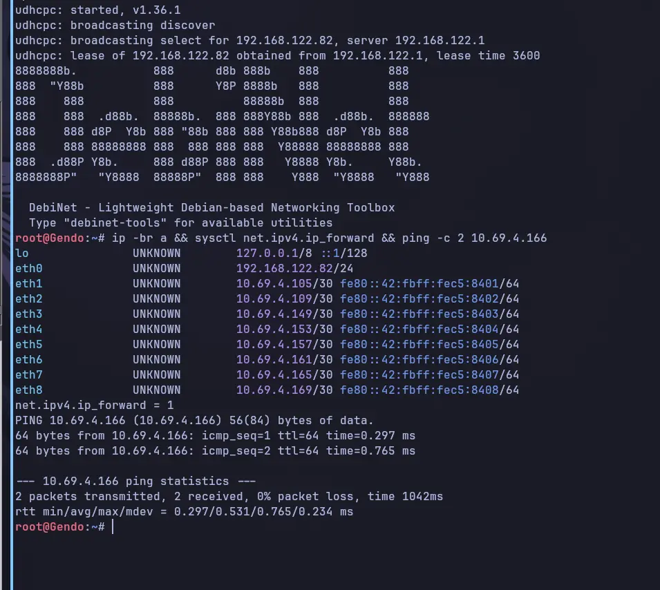
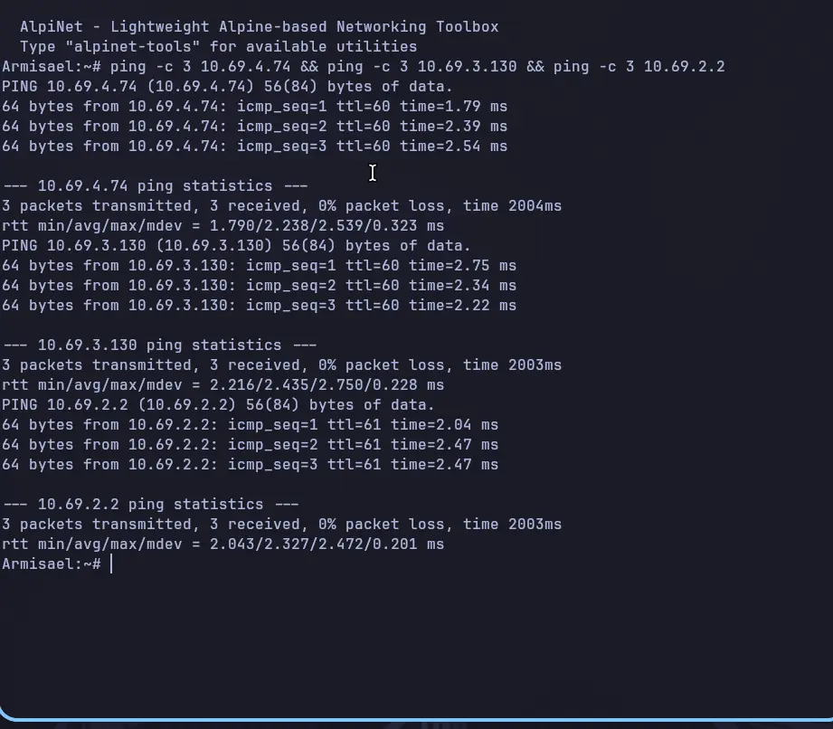
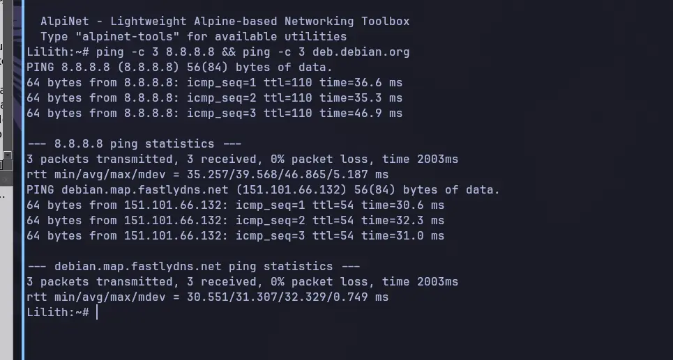
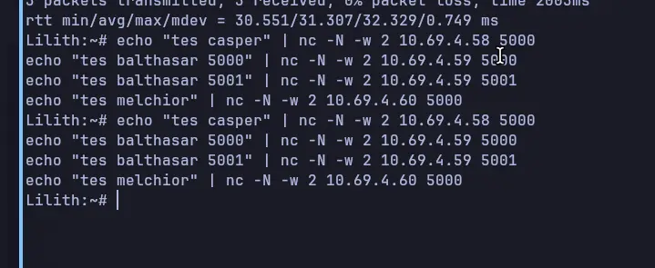

# Jarkom-Modul-5-2026-K-11

Laporan Praktikum Modul 5 — Komunikasi Data & Jaringan Komputer 2026: **Operation Geofront**.

## Anggota Kelompok

| Nama | NRP | Pembagian Pengerjaan |
|---|---|---|
| Husam Danish | 5027251060 | Soal 1–12 (VLSM, Babak 1, Babak 2) |
| Hasheemi Rafsanjani | 5027251015 | Soal 13–20 (Babak 3, Babak Final) |

## Status Pengerjaan

- [x] **Tahap 1 — Soal 1:** Perhitungan VLSM (`10.69.0.0/21`), pohon IP, spreadsheet, serta pemetaan interface & routing statis.
- [x] **Tahap 2 — Babak 1 (Soal 2–8):** Pembangunan topologi GNS3, routing statis, NAT + firewall `Gendo`, IP permanen host, serta layanan MAGI, `Pen-Pen`, dan `Tokyo3-Core`.
- [x] **Tahap 3 — Babak 2 (Soal 9–12):** Investigasi & perbaikan sabotase (`break_routing.sh`, `break_nat.sh`, `break_fw.sh`) dan mode hantu `Magi-Casper`.
- [ ] **Babak 3 & Final (Soal 13–20):** Pengamanan `Magi-Balthasar`, `Pen-Pen`, `Tokyo3-Core`, pengalihan di `Fuyutsuki`, gerbang zona sensitif `Shigeru`, isolasi `Armisael`, dan uji pemulihan (dikerjakan partner).

## Topologi


Topologi Geofront terdiri atas **60 node** (`17` router, `17` Ethernet switch, `25` container host, dan `1` `NAT1`) dengan **59 link** (`docs/cables.csv`). Pembagian image Docker:

- `ardhptr21/debinet:latest` (**23 node**): seluruh `17` router + `Magi-Casper`, `Magi-Balthasar`, `Magi-Melchior`, `Pen-Pen`, `Tokyo3-Core`, dan `Zeruel`.
- `ardhptr21/alpinet:latest` (**19 node**): seluruh `19` host klien lainnya.

> Catatan konsistensi penamaan: diagram `topo_5.png` dan tabel peran menulis `Gendou`, sedangkan teks soal, Tabel Host, dan nama file `gendo.sh` memakai `Gendo`. Laporan dan konfigurasi memakai `Gendo` secara konsisten.

---

## Babak 1: Membangun Geofront

### Soal 1: Markas Tanpa Peta (VLSM & Pohon Pembagian IP)

Prefix induk kelompok K-11 adalah `10.69.0.0/21` (`2.048` alamat, blok terkecil yang menampung total `1.196` alamat alokasi untuk `17 LAN` dan `16 link antar-router`).

- **Artefak terkait:**
  - Spreadsheet VLSM: [Spreadsheet_Modul_5_Komdat_Jarkom_2026_VLSM_K11.xlsx](Spreadsheet_Modul_5_Komdat_Jarkom_2026_VLSM_K11.xlsx)
  - Peta alamat & interface lengkap: [docs/alamat.md](docs/alamat.md)
  - Tabel routing statis & ringkasan CIDR: [docs/routing.md](docs/routing.md)
  - Daftar kabel GNS3 (59 link): [docs/cables.csv](docs/cables.csv)

#### Tabel Pembagian IP VLSM (17 LAN & 16 Link Antar-Router)

Urutan mengikuti kebutuhan ukuran blok terbesar ke terkecil, dengan *tie-break* LAN sebelum link dan urutan Tabel Host; 16 link `/30` dikelompokkan berjajar per cabang agar ringkasan CIDR pada `Gendo` optimal.

| ID | Jenis | Segmen | Network | Prefix | Gateway | Broadcast | IP Terpakai | Sisa |
|---|---|---|---|---|---|---|---:|---:|
| `L1` | LAN | Switch-Quarters (`Rei`) | `10.69.0.0` | `/23` | `10.69.0.1` | `10.69.1.255` | 501 | 9 |
| `L2` | LAN | Switch-Comm (`Hikari`) | `10.69.2.0` | `/24` | `10.69.2.1` | `10.69.2.255` | 201 | 53 |
| `L3` | LAN | Switch-Hangar (`Yui`) | `10.69.3.0` | `/25` | `10.69.3.1` | `10.69.3.127` | 101 | 25 |
| `L4` | LAN | Switch-Bunker (`Kensuke`) | `10.69.3.128` | `/26` | `10.69.3.129` | `10.69.3.191` | 56 | 6 |
| `L5` | LAN | Switch-Medic (`Maya`) | `10.69.3.192` | `/27` | `10.69.3.193` | `10.69.3.223` | 27 | 3 |
| `L6` | LAN | Switch-Relay (`Kaworu`) | `10.69.3.224` | `/27` | `10.69.3.225` | `10.69.3.255` | 26 | 4 |
| `L7` | LAN | Switch-Garden (`Shinji`) | `10.69.4.0` | `/27` | `10.69.4.1` | `10.69.4.31` | 15 | 15 |
| `L8` | LAN | Switch-Dock (`Mari`) | `10.69.4.32` | `/28` | `10.69.4.33` | `10.69.4.47` | 13 | 1 |
| `L9` | LAN | **Switch-Lab (`Ritsuko`)** *(dilingkari)* | `10.69.4.48` | `/29` | `10.69.4.49` | `10.69.4.55` | 6 | 0 |
| `L10` | LAN | Switch-Terminal (`Fuyutsuki`) | `10.69.4.56` | `/29` | `10.69.4.57` | `10.69.4.63` | 4 | 2 |
| `L11` | LAN | Switch-Cage (`Misato`) | `10.69.4.64` | `/29` | `10.69.4.65` | `10.69.4.71` | 4 | 2 |
| `L12` | LAN | Switch-Dogma (`Toji`) | `10.69.4.72` | `/29` | `10.69.4.73` | `10.69.4.79` | 3 | 3 |
| `L13` | LAN | **Switch-Monolith (`Shigeru`)** *(dilingkari)* | `10.69.4.80` | `/29` | `10.69.4.81` | `10.69.4.87` | 3 | 3 |
| `L14` | LAN | Switch-Radar (`Makoto`) | `10.69.4.88` | `/29` | `10.69.4.89` | `10.69.4.95` | 5 | 1 |
| `L15` | LAN | Switch-Archive (`Asuka`) | `10.69.4.96` | `/30` | `10.69.4.97` | `10.69.4.99` | 2 | 0 |
| `L16` | LAN | Switch-Intel (`Kaji`) | `10.69.4.100` | `/30` | `10.69.4.101` | `10.69.4.103` | 2 | 0 |
| `L17` | LAN | Switch-Cmd (`Gendo`) | `10.69.4.104` | `/30` | `10.69.4.105` | `10.69.4.107` | 2 | 0 |
| `K1` | Link | Gendo – Yui | `10.69.4.108` | `/30` | `10.69.4.109` | `10.69.4.111` | 2 | 0 |
| `K2` | Link | Asuka – Kensuke | `10.69.4.112` | `/30` | `10.69.4.113` | `10.69.4.115` | 2 | 0 |
| `K3` | Link | **Asuka – Ritsuko** *(dilingkari)* | `10.69.4.116` | `/30` | `10.69.4.117` | `10.69.4.119` | 2 | 0 |
| `K4` | Link | Fuyutsuki – Maya | `10.69.4.120` | `/30` | `10.69.4.121` | `10.69.4.123` | 2 | 0 |
| `K5` | Link | Fuyutsuki – Toji | `10.69.4.124` | `/30` | `10.69.4.125` | `10.69.4.127` | 2 | 0 |
| `K6` | Link | Yui – Rei | `10.69.4.128` | `/30` | `10.69.4.129` | `10.69.4.131` | 2 | 0 |
| `K7` | Link | Yui – Shinji | `10.69.4.132` | `/30` | `10.69.4.133` | `10.69.4.135` | 2 | 0 |
| `K8` | Link | Yui – Mari | `10.69.4.136` | `/30` | `10.69.4.137` | `10.69.4.139` | 2 | 0 |
| `K9` | Link | Hikari – Kaworu | `10.69.4.140` | `/30` | `10.69.4.141` | `10.69.4.143` | 2 | 0 |
| `K10` | Link | Shigeru – Makoto | `10.69.4.144` | `/30` | `10.69.4.145` | `10.69.4.147` | 2 | 0 |
| `K11` | Link | Gendo – Hikari | `10.69.4.148` | `/30` | `10.69.4.149` | `10.69.4.151` | 2 | 0 |
| `K12` | Link | **Gendo – Asuka** *(dilingkari)* | `10.69.4.152` | `/30` | `10.69.4.153` | `10.69.4.155` | 2 | 0 |
| `K13` | Link | Gendo – Kaji | `10.69.4.156` | `/30` | `10.69.4.157` | `10.69.4.159` | 2 | 0 |
| `K14` | Link | Gendo – Misato | `10.69.4.160` | `/30` | `10.69.4.161` | `10.69.4.163` | 2 | 0 |
| `K15` | Link | **Gendo – Shigeru** *(dilingkari)* | `10.69.4.164` | `/30` | `10.69.4.165` | `10.69.4.167` | 2 | 0 |
| `K16` | Link | Gendo – Fuyutsuki | `10.69.4.168` | `/30` | `10.69.4.169` | `10.69.4.171` | 2 | 0 |

Total blok bebas (`852` alamat): `10.69.4.172/30` (`4`), `10.69.4.176/28` (`16`), `10.69.4.192/26` (`64`), `10.69.5.0/24` (`256`), dan `10.69.6.0/23` (`512`).

#### Alamat Host Non-Router (25 Container)

> Pada `Switch-Medic`, penomoran mengikuti urutan eksplisit Tabel Host (`1. Pen-Pen`, `2. Medic-Bay`), karena pada `topo_5.png` posisi `Medic-Bay` sedikit lebih kiri dibanding `Pen-Pen`. Pada lima switch multi-host lainnya, urutan Tabel Host dan kiri-ke-kanan gambar sudah identik.

| Subnet | Switch | Gateway | Host & Alamat IP |
|---|---|---|---|
| `L1` | Switch-Quarters | `10.69.0.1` | `Quarters` (`10.69.0.2/23`) |
| `L2` | Switch-Comm | `10.69.2.1` | `Comm-Net` (`10.69.2.2/24`) |
| `L3` | Switch-Hangar | `10.69.3.1` | `Hangar-Crew` (`10.69.3.2/25`) |
| `L4` | Switch-Bunker | `10.69.3.129` | `Sachiel` (`10.69.3.130/26`) |
| `L5` | Switch-Medic | `10.69.3.193` | `Pen-Pen` (`10.69.3.194/27`), `Medic-Bay` (`10.69.3.195/27`) |
| `L6` | Switch-Relay | `10.69.3.225` | `Relay-Node` (`10.69.3.226/27`) |
| `L7` | Switch-Garden | `10.69.4.1` | `Garden-Staff` (`10.69.4.2/27`) |
| `L8` | Switch-Dock | `10.69.4.33` | `Dock-Crew` (`10.69.4.34/28`) |
| `L9` | Switch-Lab | `10.69.4.49` | `Entry-Plug` (`10.69.4.50/29`), `Dummy-Plug` (`10.69.4.51/29`) |
| `L10` | Switch-Terminal | `10.69.4.57` | `Magi-Casper` (`10.69.4.58/29`), `Magi-Balthasar` (`10.69.4.59/29`), `Magi-Melchior` (`10.69.4.60/29`) |
| `L11` | Switch-Cage | `10.69.4.65` | `Unit-01` (`10.69.4.66/29`), `Unit-02` (`10.69.4.67/29`), `Unit-00` (`10.69.4.68/29`) |
| `L12` | Switch-Dogma | `10.69.4.73` | `Lilith` (`10.69.4.74/29`), `Adam` (`10.69.4.75/29`) |
| `L13` | Switch-Monolith | `10.69.4.81` | `Zeruel` (`10.69.4.82/29`), `Armisael` (`10.69.4.83/29`) |
| `L14` | Switch-Radar | `10.69.4.89` | `Radar-Array` (`10.69.4.90/29`) |
| `L15` | Switch-Archive | `10.69.4.97` | `Archive-Vault` (`10.69.4.98/30`) |
| `L16` | Switch-Intel | `10.69.4.101` | `Spy` (`10.69.4.102/30`) |
| `L17` | Switch-Cmd | `10.69.4.105` | `Tokyo3-Core` (`10.69.4.106/30`) |

#### Gambar Pohon Pembagian IP


Sumber diagram: [vlsm-tree.dot](docs/images/vlsm-tree.dot) ([SVG](docs/images/vlsm-tree.svg)). Lima subnet pada jalur **Dummy-Plug ke Armisael** yang dilingkari oval merah tebal adalah:

1. `L9` (`10.69.4.48/29`) — `Switch-Lab` (`Dummy-Plug` di `10.69.4.51` menuju gateway `Ritsuko` di `10.69.4.49`)
2. `K3` (`10.69.4.116/30`) — Link `Ritsuko` (`10.69.4.118`) ↔ `Asuka` (`10.69.4.117`)
3. `K12` (`10.69.4.152/30`) — Link `Asuka` (`10.69.4.154`) ↔ `Gendo` (`10.69.4.153`)
4. `K15` (`10.69.4.164/30`) — Link `Gendo` (`10.69.4.165`) ↔ `Shigeru` (`10.69.4.166`)
5. `L13` (`10.69.4.80/29`) — `Switch-Monolith` (gateway `Shigeru` di `10.69.4.81` menuju `Armisael` di `10.69.4.83`)

#### Penjelasan Hitungan Satu Subnet: `L7` (`Switch-Garden` — `10.69.4.0/27`)

1. **Menentukan kebutuhan alamat usable:** pada Tabel Host, `Garden-Staff` membutuhkan `14` host, ditambah `1` alamat untuk gateway router `Shinji`, sehingga total IP usable yang dibutuhkan adalah $14 + 1 = 15$.
2. **Memilih prefix terkecil yang muat:** jumlah IP usable untuk $h$ bit host adalah $2^h - 2$.
   - Jika memakai $h = 4$ (`/28`), kapasitas usable hanya $2^4 - 2 = 14$ (kurang `1` alamat karena gateway ikut dihitung).
   - Maka dipilih $h = 5$, menghasilkan kapasitas usable $2^5 - 2 = 30 \ge 15$, dengan ukuran blok $2^5 = 32$ alamat dan prefix $32 - 5 = /27$ (`255.255.255.224`).
3. **Menentukan alamat awal (Network ID):** enam subnet sebelumnya (`L1`–`L6`) menempati blok secara berurutan dari `10.69.0.0` hingga `10.69.3.255` (`512 + 256 + 128 + 64 + 32 + 32 = 1.024` alamat). Alamat kosong berikutnya adalah `10.69.4.0`, yang kelipatan `32` ($0 \bmod 32 = 0$), sehingga Network ID `L7` adalah `10.69.4.0/27`.
4. **Menentukan batas alamat dan sisa:**
   - **Network ID:** `10.69.4.0`
   - **Gateway (`Shinji`, usable pertama):** `10.69.4.1`
   - **Container `Garden-Staff` (usable kedua):** `10.69.4.2` (mencadangkan 14 alamat grup host hingga `10.69.4.15`)
   - **Rentang usable:** `10.69.4.1 - 10.69.4.30`
   - **Broadcast:** `10.69.4.0 + 32 - 1 = 10.69.4.31`
   - **IP terpakai / Sisa:** `15` terpakai (`14` host + `1` gateway), sisa $30 - 15 = 15$ IP usable.

---

### Soal 2: Geofront Gelap Gulita (Interface Router & IP Forwarding)

Topologi `60` node dan `59` kabel dibangun pada project GNS3 `K-11-MODUL-5` melalui [build_topology.py](tools/build_topology.py). Setiap router memperoleh konfigurasi `/etc/network/interfaces` sesuai [docs/alamat.md](docs/alamat.md) dan IPv4 forwarding (`net.ipv4.ip_forward = 1`). Hanya `Gendo` (`eth0`) yang tersambung ke `NAT1` melalui DHCP (`192.168.122.82/24`).

Bukti lengkap seluruh `17` router (`ip -br a`, `ip_forward = 1`) serta uji ping dua arah (`32` arah pada `16` link router-ke-router): [evidence/babak1/soal2.txt](evidence/babak1/soal2.txt).

```text
--- Gendo (dijalankan di Gendo) ---
lo               UNKNOWN        127.0.0.1/8 ::1/128
eth0             UNKNOWN        192.168.122.82/24
eth1             UNKNOWN        10.69.4.105/30
eth2             UNKNOWN        10.69.4.109/30
eth3             UNKNOWN        10.69.4.149/30
eth4             UNKNOWN        10.69.4.153/30
eth5             UNKNOWN        10.69.4.157/30
eth6             UNKNOWN        10.69.4.161/30
eth7             UNKNOWN        10.69.4.165/30
eth8             UNKNOWN        10.69.4.169/30
net.ipv4.ip_forward = 1
```

Seluruh `32` ping ujung-ke-ujung link `K1`–`K16` tercatat `0% packet loss`.




---

### Soal 3: Pulau-Pulau yang Terpisah (Routing Statis & Ringkasan CIDR)

Setiap router dikonfigurasi dengan script idempoten (`/root/<nama>.sh`, cadangan di [script/](script/)) memakai `ip route replace`. Router di bawah `Gendo` memakai `default` ke router induk + rute spesifik LAN anak, sedangkan `Gendo` memakai `default` via `NAT1` (`eth0`) dan `21` rute cabang hasil `4` ringkasan CIDR eksak (`10.69.4.80/28`, `10.69.4.112/29`, `10.69.4.120/29`, `10.69.4.128/29`). Rincian lengkap: [docs/routing.md](docs/routing.md) dan [evidence/babak1/soal3.txt](evidence/babak1/soal3.txt).

Uji sementara dari `Armisael` (`10.69.4.83`) ke tiga cabang berbeda berhasil (`0% packet loss`):
- `ping -c 3 10.69.4.74` (`Lilith`): `3 transmitted, 3 received, 0% packet loss`
- `ping -c 3 10.69.3.130` (`Sachiel`): `3 transmitted, 3 received, 0% packet loss`
- `ping -c 3 10.69.2.2` (`Comm-Net`): `3 transmitted, 3 received, 0% packet loss`




---

### Soal 4: Haus Kabar dari Dunia Luar (NAT Dinamis & DNS)

Pada `Gendo` ([script/gendo.sh](script/gendo.sh)), ditambahkan NAT dinamis (`MASQUERADE`) berbasis interface keluar `eth0` dan prefix internal `10.69.0.0/21` sehingga konfigurasi tidak bergantung pada IP DHCP `NAT1` yang bisa berubah, sementara traffic antar-LAN tetap memakai IP asli pengirimnya:

```sh
iptables -t nat -C POSTROUTING -s 10.69.0.0/21 -o eth0 -j MASQUERADE 2>/dev/null || \
  iptables -t nat -A POSTROUTING -s 10.69.0.0/21 -o eth0 -j MASQUERADE
```

Bukti di [evidence/babak1/soal4.txt](evidence/babak1/soal4.txt):
- Ping antar-LAN `Armisael` → `Lilith` (`10.69.4.74`) **tidak** menaikkan counter `MASQUERADE` (`0 packets`).
- `Armisael` dan `Lilith` berhasil `ping -c 3 8.8.8.8` dan `ping -c 3 deb.debian.org` (`0% packet loss`), dan counter `MASQUERADE` di `Gendo` naik menjadi `12 pkts / 868 bytes`.




---

### Soal 5: Pintu Depan Dikunci Rapat (Lockdown `Gendo`)

Seluruh aturan Soal 2–5 digabung secara idempoten di `/root/gendo.sh` ([script/gendo.sh](script/gendo.sh)): policy `INPUT` dan `FORWARD` diubah ke `DROP` setelah mengizinkan `lo`, `ESTABLISHED,RELATED`, DHCP dari `NAT1` (`eth0` UDP `67 -> 68`), serta traffic `10.69.0.0/21` (`! -i eth0`) untuk internet (`-o eth0`), antar-LAN (`! -o eth0`), dan ke `Gendo` sendiri.

```text
--- iptables -S @ Gendo ---
-P INPUT DROP
-P FORWARD DROP
-P OUTPUT ACCEPT
-A INPUT -i lo -j ACCEPT
-A INPUT -m conntrack --ctstate RELATED,ESTABLISHED -j ACCEPT
-A INPUT -i eth0 -p udp -m udp --sport 67 --dport 68 -j ACCEPT
-A INPUT -s 10.69.0.0/21 ! -i eth0 -j ACCEPT
-A FORWARD -m conntrack --ctstate RELATED,ESTABLISHED -j ACCEPT
-A FORWARD -s 10.69.0.0/21 ! -i eth0 -o eth0 -j ACCEPT
-A FORWARD -s 10.69.0.0/21 -d 10.69.0.0/21 ! -i eth0 ! -o eth0 -j ACCEPT
```

Bukti di [evidence/babak1/soal5.txt](evidence/babak1/soal5.txt):
- Menjalankan `bash /root/gendo.sh` dua kali berturut-turut menghasilkan rule identik (`10` baris `filter`, `5` baris `nat`).
- `Armisael` tetap berhasil ping ke `8.8.8.8`, `Lilith` (`10.69.4.74`), dan `Gendo` (`10.69.4.165`), sementara ping baru dari sisi `NAT1` (`virbr0` → `192.168.122.82`) ditolak (`100% packet loss`).


---

### Soal 6: Alamat Para Pilot (IP Statis Permanen 25 Host)

Seluruh `25` host non-router dikonfigurasi permanen melalui `/etc/network/interfaces` dan `/root/init.sh` (resolver DNS saat boot). `Unit-01` di-restart penuh (`stop` + `start`) untuk memverifikasi persistensi:

```text
--- Unit-01 (dijalankan di Unit-01 setelah restart) ---
lo               UNKNOWN        127.0.0.1/8 ::1/128
eth0             UNKNOWN        10.69.4.66/29
default via 10.69.4.65 dev eth0
PING 10.69.4.65: 3 packets transmitted, 3 received, 0% packet loss
```

Seluruh `25` host lolos uji IP, gateway, dan `8.8.8.8` di [evidence/babak1/soal6.txt](evidence/babak1/soal6.txt).


---

### Soal 7: Membangunkan MAGI

Paket `iptables` dan `netcat-traditional` dipasang lewat script idempoten [script/magi-casper.sh](script/magi-casper.sh), [script/magi-balthasar.sh](script/magi-balthasar.sh), dan [script/magi-melchior.sh](script/magi-melchior.sh) (`/root/<nama>.sh`), serta menjalankan listener TCP `nc.traditional`:
- `Magi-Casper` (`10.69.4.58`): TCP `5000`
- `Magi-Balthasar` (`10.69.4.59`): TCP `5000` dan `5001`
- `Magi-Melchior` (`10.69.4.60`): TCP `5000`

Uji kirim `nc -N -w 2` dari `Lilith` (`10.69.4.74`) ke keempat port keluar dengan `exit=0`, dan seluruh pesan tercatat di `/var/log/magi-<port>.log` masing-masing node ([evidence/babak1/soal7.txt](evidence/babak1/soal7.txt)).




---

### Soal 8: Mengenali Kondisi Normal (`Pen-Pen` & `Tokyo3-Core`)

Responder `nc.traditional` dipasang via [script/pen-pen.sh](script/pen-pen.sh) dan [script/tokyo3-core.sh](script/tokyo3-core.sh):
- `Pen-Pen` (`10.69.3.194:80`) → `Welcome to Pen-Pen`
- `Tokyo3-Core` (`10.69.4.106:80`) → `Welcome to Tokyo3-Core`
- `Tokyo3-Core` (`10.69.4.106:8080`) → `syifa imutz`

Uji dari `Lilith` dua kali per port mengembalikan banner yang tepat, dan probe ke port tertutup `22` (`nc -zv -w 3`) langsung gagal dalam `0.058s` (`Connection refused`, bukan menggantung hingga timeout): [evidence/babak1/soal8.txt](evidence/babak1/soal8.txt).


---

## Babak 2: Sabotase dan Hantu MAGI

Seluruh script sabotase (`break_routing.sh`, `break_nat.sh`, `break_fw.sh`) diunduh langsung dan dijalankan di dalam container target tanpa membaca isi scriptnya; diagnosa dilakukan murni dari selisih (*diff*) kondisi kernel dan gejala jaringan ([evidence/babak2/](evidence/babak2/)).

### Soal 9: Jalur Belakang Diutak-atik (`break_routing.sh` di `Shigeru`)

**Penyebab yang ditemukan:**
1. **`net.ipv4.ip_forward` dinonaktifkan menjadi `0`** (termasuk `conf.*.forwarding = 0`), sehingga `Shigeru` berhenti meneruskan paket antar-interface.
2. **Default route dibelokkan ke router anak `Makoto`** (`default via 10.69.4.146 dev eth2`), bukan ke upstream `Gendo` (`10.69.4.165 dev eth0`).
3. **Rute `blackhole 10.69.4.72/29`** ditambahkan di tabel `main`, menjatuhkan seluruh traffic menuju `Switch-Dogma` (`Lilith`).
4. **Policy routing rule `90: from all iif eth1 lookup 100` dengan isi `unreachable default table 100`** menangkap seluruh paket yang masuk dari `Switch-Monolith` (`Armisael`) sebelum sempat memakai tabel `main`.

**Penjelasan gejala:**
- `Armisael` tetap bisa ping gateway-nya sendiri (`10.69.4.81`) karena paket ditujukan ke alamat lokal router (`table local` prioritas `0` berada di atas aturan `90`) dan tidak memerlukan `ip_forward = 1`.
- `Lilith` tidak mendapat jawaban dari `Armisael` karena forwarding mati (`ip_forward = 0`), paket balasan dari `Armisael` di `eth1` langsung ditolak oleh `rule 90 -> table 100 unreachable`, dan rute balik ke `10.69.4.72/29` terkena `blackhole`.

**Perbaikan (`Shigeru`):**

```sh
ip route del blackhole 10.69.4.72/29
ip rule del pref 90
ip route flush table 100
bash /root/shigeru.sh   # mengembalikan ip_forward=1, default via 10.69.4.165 dev eth0, dan rute 10.69.4.88/29
```

**Bukti verifikasi ([evidence/babak2/soal9.txt](evidence/babak2/soal9.txt)):**
- `Lilith` → `Armisael` (`10.69.4.83`): `3 transmitted, 3 received, 0% packet loss`.
- `Armisael` → `Lilith` (`10.69.4.74`) dan `8.8.8.8`: `0% packet loss`.

<!-- TODO: screenshot hasil perbaikan Soal 9 di Shigeru dan ping Lilith -> Armisael -->

---

### Soal 10: Para Pilot Terkunci di Dalam (`break_nat.sh` di `Misato` & `Gendo`)

**Dua penyebab yang ditemukan:**
1. **Di `Misato` (tabel `nat` `POSTROUTING`):** ditambahkan rule:
   ```text
   -A POSTROUTING -s 10.69.4.64/29 ! -d 10.69.0.0/16 -o eth0 -j SNAT --to-source 172.31.99.1
   ```
   Untuk tujuan non-internal (internet `8.8.8.8`), alamat sumber `Switch-Cage` (`10.69.4.64/29`) diterjemahkan lebih dulu oleh `Misato` menjadi `172.31.99.1`, sehingga di `Gendo` paket tersebut tidak cocok dengan aturan `FORWARD` maupun `MASQUERADE` `10.69.0.0/21` dan langsung di-`DROP`.
2. **Di `Gendo` (tabel `nat` `POSTROUTING`):** disisipkan rule di atas `MASQUERADE`:
   ```text
   -A POSTROUTING -s 10.69.4.64/29 -o eth0 -j RETURN
   ```
   Jika hanya `Misato` yang dibersihkan, paket `Switch-Cage` keluar ke `NAT1` tanpa NAT karena `RETURN` menghentikan evaluasi chain `POSTROUTING` sebelum rule `MASQUERADE`.

**Jawaban pertanyaan analisis:**
- **Mengapa `Switch-Cage` terdampak tetapi `Switch-Intel` (`Spy`) tidak:** kedua rule sabotase menyasar spesifik prefix `10.69.4.64/29` (`Switch-Cage` di bawah `Misato`), sedangkan `Spy` berada pada `10.69.4.100/30` di bawah `Kaji`. Sementara `Cage -> Lilith` (`10.69.4.74`) tetap normal karena tujuan masih berada di dalam `10.69.0.0/16` (`! -d 10.69.0.0/16` tidak cocok).
- **Di router mana alamat sumber diterjemahkan:** saat sabotase aktif ke internet, alamat sumber diterjemahkan lebih dulu di **`Misato`** menjadi `172.31.99.1`; dalam kondisi normal setelah perbaikan, terjemahan alamat sumber (`MASQUERADE`) hanya terjadi di router tepi **`Gendo`** (`eth0` menuju `NAT1`).

**Perbaikan (`Misato` & `Gendo`):**

```sh
# Dijalankan di Misato
iptables -t nat -D POSTROUTING -s 10.69.4.64/29 ! -d 10.69.0.0/16 -o eth0 -j SNAT --to-source 172.31.99.1

# Dijalankan di Gendo
iptables -t nat -D POSTROUTING -s 10.69.4.64/29 -o eth0 -j RETURN
bash /root/gendo.sh
```

**Bukti verifikasi ([evidence/babak2/soal10.txt](evidence/babak2/soal10.txt)):**
- `Unit-01`, `Unit-02`, `Unit-00`, `Spy`, dan `Armisael` seluruhnya berhasil `ping -c 3 8.8.8.8` (`0% packet loss`).

<!-- TODO: screenshot hasil perbaikan Soal 10 di Misato/Gendo dan ping Unit-01 -> 8.8.8.8 -->

---

### Soal 11: Casper Harus Jadi Hantu (`Magi-Casper`)

Pada [script/magi-casper.sh](script/magi-casper.sh) (`/root/magi-casper.sh`), ditambahkan aturan idempoten untuk membuang seluruh ICMP `echo-request` masuk sambil menjaga ping keluar (`echo-reply`) dan layanan TCP `5000` tetap berjalan:

```sh
iptables -C INPUT -p icmp --icmp-type echo-request -j DROP 2>/dev/null || \
  iptables -A INPUT -p icmp --icmp-type echo-request -j DROP
```

**Bukti verifikasi ([evidence/babak2/soal11.txt](evidence/babak2/soal11.txt)):**
- `Magi-Balthasar` (`10.69.4.59`) → `ping 10.69.4.58`: `100% packet loss` (gagal, meski satu switch).
- `Lilith` (`10.69.4.74`) → `ping 10.69.4.58`: `100% packet loss` (gagal).
- `Magi-Casper` → `ping 10.69.4.59` (`Magi-Balthasar`) & `10.69.4.74` (`Lilith`): keduanya `3 received, 0% packet loss`.
- `Lilith` → `Magi-Casper:5000` (`nc -N -w 2`): `exit=0`, pesan tercatat di `/var/log/magi-5000.log`.

<!-- TODO: screenshot mode hantu Casper Soal 11 -->

---

### Soal 12: Teknisi yang Kelewat Semangat (`break_fw.sh` di `Magi-Casper`)

**Empat penyebab yang ditemukan:**
1. **Policy `INPUT` diubah menjadi `DROP` tanpa rule `ESTABLISHED,RELATED`**, sehingga balasan ping `8.8.8.8` maupun balasan HTTP/DNS untuk `apt-get update` terbuang di `INPUT`.
2. **Rule `-A INPUT -p icmp -j DROP`** memblokir seluruh tipe ICMP (bukan hanya `echo-request`), ikut menghalangi balasan ICMP untuk ping keluar.
3. **Tidak ada rule izin masuk untuk layanan TCP port `5000`**, sehingga `Unit-00` gagal terhubung ke port `5000` Casper.
4. **Rule `-A OUTPUT -p udp --dport 53 -j DROP`** memblokir query DNS keluar, sehingga `apt-get update` gagal me-resolve `deb.debian.org`.

**Perbaikan tanpa membatalkan tujuan hardening (`Magi-Casper`, [script/magi-casper.sh](script/magi-casper.sh)):**
Menghapus dua rule sabotase (`-D INPUT -p icmp -j DROP` dan `-D OUTPUT -p udp --dport 53 -j DROP`), lalu menerapkan policy `INPUT DROP` dan `FORWARD DROP` dengan aturan izin minimal secara idempoten:

```text
-P INPUT DROP
-P FORWARD DROP
-P OUTPUT ACCEPT
-A INPUT -i lo -j ACCEPT
-A INPUT -m conntrack --ctstate RELATED,ESTABLISHED -j ACCEPT
-A INPUT -p tcp -m tcp --dport 5000 -j ACCEPT
-A INPUT -p icmp -m icmp --icmp-type 8 -j DROP
```

**Bukti verifikasi ([evidence/babak2/soal12.txt](evidence/babak2/soal12.txt)):**
- `Unit-00` (`10.69.4.68`) → `Magi-Casper:5000` (`nc -N -w 2 10.69.4.58 5000`): `exit=0`, pesan masuk ke `/var/log/magi-5000.log`.
- `apt-get update` di `Magi-Casper`: berhasil (`Hit` seluruh repositori Debian, tanpa error DNS).
- `Magi-Casper` → `ping 8.8.8.8`, `Magi-Balthasar`, `Lilith`: seluruhnya `0% packet loss`.
- Ping masuk dari `Magi-Balthasar` & `Lilith` ke `Magi-Casper` serta koneksi ke port `22` dari `Unit-00` tetap ditolak (`policy INPUT DROP`).

<!-- TODO: screenshot iptables -S, nc Unit-00 -> Casper:5000, dan apt-get update @ Magi-Casper -->

---

**Handoff ke Partner:** proyek diekspor ke [K-11-MODUL-5.gns3project](K-11-MODUL-5.gns3project) dengan panduan lanjutan untuk Soal 13–20 di [HANDOFF.md](HANDOFF.md).
