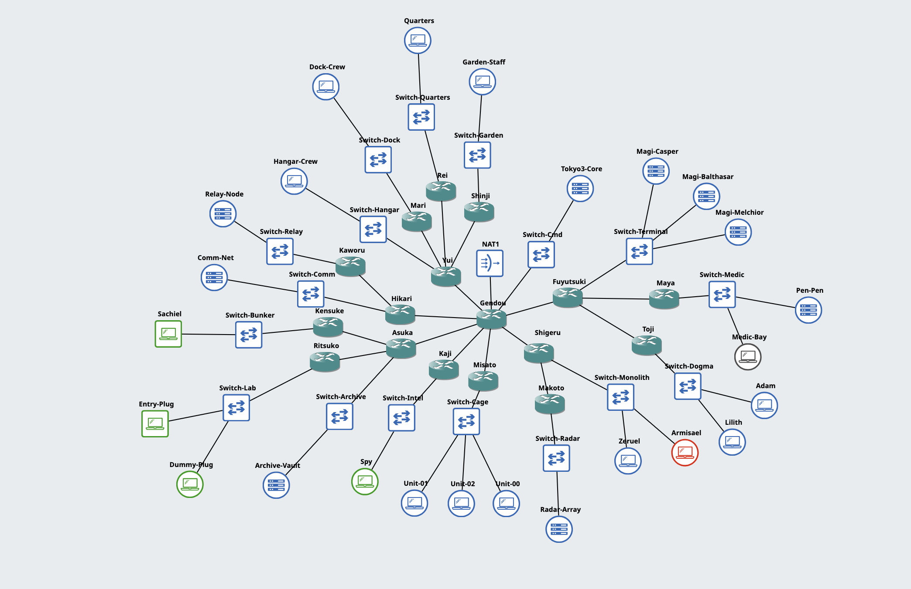
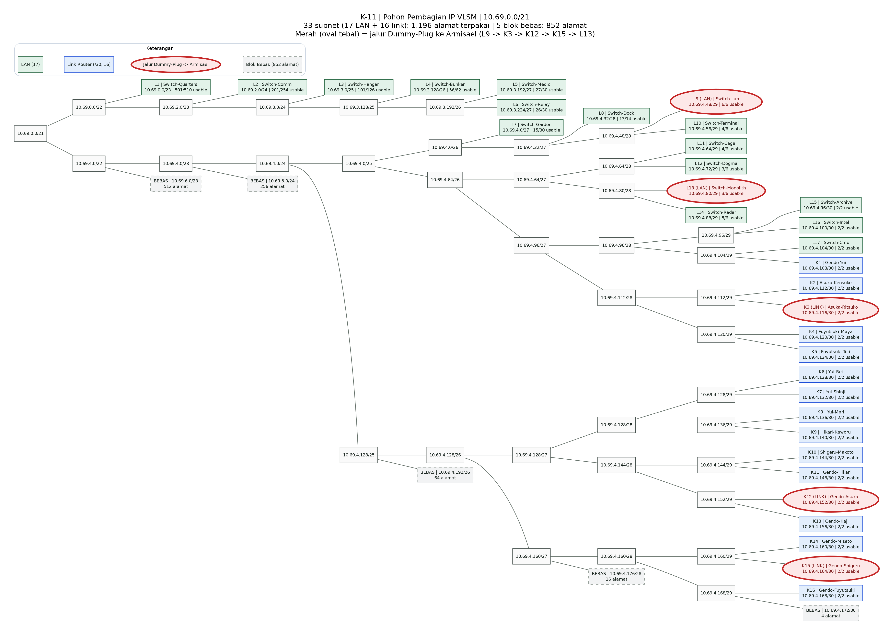

# Jarkom-Modul-5-2026-K-11

Laporan Praktikum Modul 5 — Komunikasi Data & Jaringan Komputer 2026: **Operation Geofront**.

## Anggota Kelompok

| Nama | NRP | Pembagian Pengerjaan |
|---|---|---|
| Husam Danish | 5027251060 | Soal 1–12 (VLSM, Babak 1, Babak 2) |
| Hasheemi Rafsanjani | 5027251015 | Soal 13–20 (Babak 3, Babak Final) |

## Status Pengerjaan

- [x] **Tahap 1 — Soal 1:** Perhitungan VLSM (`10.69.0.0/21`), pohon IP, spreadsheet, serta pemetaan interface & routing statis.
- [ ] **Tahap 2 — Babak 1 (Soal 2–8):** Pembangunan topologi GNS3, routing statis, NAT + firewall `Gendo`, IP permanen host, serta layanan MAGI, `Pen-Pen`, dan `Tokyo3-Core`.
- [ ] **Tahap 3 — Babak 2 (Soal 9–12):** Investigasi & perbaikan sabotase (`break_routing.sh`, `break_nat.sh`, `break_fw.sh`) dan mode hantu `Magi-Casper`.
- [ ] **Babak 3 & Final (Soal 13–20):** Pengamanan `Magi-Balthasar`, `Pen-Pen`, `Tokyo3-Core`, pengalihan di `Fuyutsuki`, gerbang zona sensitif `Shigeru`, isolasi `Armisael`, dan uji pemulihan (dikerjakan partner).

## Topologi

Topologi Geofront terdiri atas **60 node** (`17` router, `17` Ethernet switch, `25` container host, dan `1` `NAT1`) dengan **59 link** (`docs/cables.csv`). Pembagian image Docker:

- `ardhptr21/debinet:latest` (**23 node**): seluruh `17` router + `Magi-Casper`, `Magi-Balthasar`, `Magi-Melchior`, `Pen-Pen`, `Tokyo3-Core`, dan `Zeruel`.
- `ardhptr21/alpinet:latest` (**19 node**): seluruh `19` host klien lainnya.

> Catatan konsistensi penamaan: diagram `topo_5.png` dan tabel peran menulis `Gendou`, sedangkan teks soal, Tabel Host, dan nama file `gendo.sh` memakai `Gendo`. Laporan dan konfigurasi memakai `Gendo` secara konsisten.

---

## Babak 1: Membangun Geofront

### Soal 1: Markas Tanpa Peta (VLSM & Pohon Pembagian IP)

Prefix induk kelompok K-11 adalah `10.69.0.0/21` (`2.048` alamat, blok terkecil yang menampung total `1.196` alamat alokasi untuk `17 LAN` dan `16 link antar-router`).

- **Artefak terkait:**
  - Spreadsheet VLSM: [Spreadsheet_Modul_5_Komdat_Jarkom_2026_VLSM_K11.xlsx](Spreadsheet_Modul_5_Komdat_Jarkom_2026_VLSM_K11.xlsx)
  - Peta alamat & interface lengkap: [docs/alamat.md](docs/alamat.md)
  - Tabel routing statis & ringkasan CIDR: [docs/routing.md](docs/routing.md)
  - Daftar kabel GNS3 (59 link): [docs/cables.csv](docs/cables.csv)

#### Tabel Pembagian IP VLSM (17 LAN & 16 Link Antar-Router)

Urutan mengikuti kebutuhan ukuran blok terbesar ke terkecil, dengan *tie-break* LAN sebelum link dan urutan Tabel Host; 16 link `/30` dikelompokkan berjajar per cabang agar ringkasan CIDR pada `Gendo` optimal.

| ID | Jenis | Segmen | Network | Prefix | Gateway | Broadcast | IP Terpakai | Sisa |
|---|---|---|---|---|---|---|---:|---:|
| `L1` | LAN | Switch-Quarters (`Rei`) | `10.69.0.0` | `/23` | `10.69.0.1` | `10.69.1.255` | 501 | 9 |
| `L2` | LAN | Switch-Comm (`Hikari`) | `10.69.2.0` | `/24` | `10.69.2.1` | `10.69.2.255` | 201 | 53 |
| `L3` | LAN | Switch-Hangar (`Yui`) | `10.69.3.0` | `/25` | `10.69.3.1` | `10.69.3.127` | 101 | 25 |
| `L4` | LAN | Switch-Bunker (`Kensuke`) | `10.69.3.128` | `/26` | `10.69.3.129` | `10.69.3.191` | 56 | 6 |
| `L5` | LAN | Switch-Medic (`Maya`) | `10.69.3.192` | `/27` | `10.69.3.193` | `10.69.3.223` | 27 | 3 |
| `L6` | LAN | Switch-Relay (`Kaworu`) | `10.69.3.224` | `/27` | `10.69.3.225` | `10.69.3.255` | 26 | 4 |
| `L7` | LAN | Switch-Garden (`Shinji`) | `10.69.4.0` | `/27` | `10.69.4.1` | `10.69.4.31` | 15 | 15 |
| `L8` | LAN | Switch-Dock (`Mari`) | `10.69.4.32` | `/28` | `10.69.4.33` | `10.69.4.47` | 13 | 1 |
| `L9` | LAN | **Switch-Lab (`Ritsuko`)** *(dilingkari)* | `10.69.4.48` | `/29` | `10.69.4.49` | `10.69.4.55` | 6 | 0 |
| `L10` | LAN | Switch-Terminal (`Fuyutsuki`) | `10.69.4.56` | `/29` | `10.69.4.57` | `10.69.4.63` | 4 | 2 |
| `L11` | LAN | Switch-Cage (`Misato`) | `10.69.4.64` | `/29` | `10.69.4.65` | `10.69.4.71` | 4 | 2 |
| `L12` | LAN | Switch-Dogma (`Toji`) | `10.69.4.72` | `/29` | `10.69.4.73` | `10.69.4.79` | 3 | 3 |
| `L13` | LAN | **Switch-Monolith (`Shigeru`)** *(dilingkari)* | `10.69.4.80` | `/29` | `10.69.4.81` | `10.69.4.87` | 3 | 3 |
| `L14` | LAN | Switch-Radar (`Makoto`) | `10.69.4.88` | `/29` | `10.69.4.89` | `10.69.4.95` | 5 | 1 |
| `L15` | LAN | Switch-Archive (`Asuka`) | `10.69.4.96` | `/30` | `10.69.4.97` | `10.69.4.99` | 2 | 0 |
| `L16` | LAN | Switch-Intel (`Kaji`) | `10.69.4.100` | `/30` | `10.69.4.101` | `10.69.4.103` | 2 | 0 |
| `L17` | LAN | Switch-Cmd (`Gendo`) | `10.69.4.104` | `/30` | `10.69.4.105` | `10.69.4.107` | 2 | 0 |
| `K1` | Link | Gendo – Yui | `10.69.4.108` | `/30` | `10.69.4.109` | `10.69.4.111` | 2 | 0 |
| `K2` | Link | Asuka – Kensuke | `10.69.4.112` | `/30` | `10.69.4.113` | `10.69.4.115` | 2 | 0 |
| `K3` | Link | **Asuka – Ritsuko** *(dilingkari)* | `10.69.4.116` | `/30` | `10.69.4.117` | `10.69.4.119` | 2 | 0 |
| `K4` | Link | Fuyutsuki – Maya | `10.69.4.120` | `/30` | `10.69.4.121` | `10.69.4.123` | 2 | 0 |
| `K5` | Link | Fuyutsuki – Toji | `10.69.4.124` | `/30` | `10.69.4.125` | `10.69.4.127` | 2 | 0 |
| `K6` | Link | Yui – Rei | `10.69.4.128` | `/30` | `10.69.4.129` | `10.69.4.131` | 2 | 0 |
| `K7` | Link | Yui – Shinji | `10.69.4.132` | `/30` | `10.69.4.133` | `10.69.4.135` | 2 | 0 |
| `K8` | Link | Yui – Mari | `10.69.4.136` | `/30` | `10.69.4.137` | `10.69.4.139` | 2 | 0 |
| `K9` | Link | Hikari – Kaworu | `10.69.4.140` | `/30` | `10.69.4.141` | `10.69.4.143` | 2 | 0 |
| `K10` | Link | Shigeru – Makoto | `10.69.4.144` | `/30` | `10.69.4.145` | `10.69.4.147` | 2 | 0 |
| `K11` | Link | Gendo – Hikari | `10.69.4.148` | `/30` | `10.69.4.149` | `10.69.4.151` | 2 | 0 |
| `K12` | Link | **Gendo – Asuka** *(dilingkari)* | `10.69.4.152` | `/30` | `10.69.4.153` | `10.69.4.155` | 2 | 0 |
| `K13` | Link | Gendo – Kaji | `10.69.4.156` | `/30` | `10.69.4.157` | `10.69.4.159` | 2 | 0 |
| `K14` | Link | Gendo – Misato | `10.69.4.160` | `/30` | `10.69.4.161` | `10.69.4.163` | 2 | 0 |
| `K15` | Link | **Gendo – Shigeru** *(dilingkari)* | `10.69.4.164` | `/30` | `10.69.4.165` | `10.69.4.167` | 2 | 0 |
| `K16` | Link | Gendo – Fuyutsuki | `10.69.4.168` | `/30` | `10.69.4.169` | `10.69.4.171` | 2 | 0 |

Total blok bebas (`852` alamat): `10.69.4.172/30` (`4`), `10.69.4.176/28` (`16`), `10.69.4.192/26` (`64`), `10.69.5.0/24` (`256`), dan `10.69.6.0/23` (`512`).

#### Alamat Host Non-Router (25 Container)

> Pada `Switch-Medic`, penomoran mengikuti urutan eksplisit Tabel Host (`1. Pen-Pen`, `2. Medic-Bay`), karena pada `topo_5.png` posisi `Medic-Bay` sedikit lebih kiri dibanding `Pen-Pen`. Pada lima switch multi-host lainnya, urutan Tabel Host dan kiri-ke-kanan gambar sudah identik.

| Subnet | Switch | Gateway | Host & Alamat IP |
|---|---|---|---|
| `L1` | Switch-Quarters | `10.69.0.1` | `Quarters` (`10.69.0.2/23`) |
| `L2` | Switch-Comm | `10.69.2.1` | `Comm-Net` (`10.69.2.2/24`) |
| `L3` | Switch-Hangar | `10.69.3.1` | `Hangar-Crew` (`10.69.3.2/25`) |
| `L4` | Switch-Bunker | `10.69.3.129` | `Sachiel` (`10.69.3.130/26`) |
| `L5` | Switch-Medic | `10.69.3.193` | `Pen-Pen` (`10.69.3.194/27`), `Medic-Bay` (`10.69.3.195/27`) |
| `L6` | Switch-Relay | `10.69.3.225` | `Relay-Node` (`10.69.3.226/27`) |
| `L7` | Switch-Garden | `10.69.4.1` | `Garden-Staff` (`10.69.4.2/27`) |
| `L8` | Switch-Dock | `10.69.4.33` | `Dock-Crew` (`10.69.4.34/28`) |
| `L9` | Switch-Lab | `10.69.4.49` | `Entry-Plug` (`10.69.4.50/29`), `Dummy-Plug` (`10.69.4.51/29`) |
| `L10` | Switch-Terminal | `10.69.4.57` | `Magi-Casper` (`10.69.4.58/29`), `Magi-Balthasar` (`10.69.4.59/29`), `Magi-Melchior` (`10.69.4.60/29`) |
| `L11` | Switch-Cage | `10.69.4.65` | `Unit-01` (`10.69.4.66/29`), `Unit-02` (`10.69.4.67/29`), `Unit-00` (`10.69.4.68/29`) |
| `L12` | Switch-Dogma | `10.69.4.73` | `Lilith` (`10.69.4.74/29`), `Adam` (`10.69.4.75/29`) |
| `L13` | Switch-Monolith | `10.69.4.81` | `Zeruel` (`10.69.4.82/29`), `Armisael` (`10.69.4.83/29`) |
| `L14` | Switch-Radar | `10.69.4.89` | `Radar-Array` (`10.69.4.90/29`) |
| `L15` | Switch-Archive | `10.69.4.97` | `Archive-Vault` (`10.69.4.98/30`) |
| `L16` | Switch-Intel | `10.69.4.101` | `Spy` (`10.69.4.102/30`) |
| `L17` | Switch-Cmd | `10.69.4.105` | `Tokyo3-Core` (`10.69.4.106/30`) |

#### Gambar Pohon Pembagian IP

Sumber diagram: [vlsm-tree.dot](docs/images/vlsm-tree.dot) ([SVG](docs/images/vlsm-tree.svg)). Lima subnet pada jalur **Dummy-Plug ke Armisael** yang dilingkari oval merah tebal adalah:

1. `L9` (`10.69.4.48/29`) — `Switch-Lab` (`Dummy-Plug` di `10.69.4.51` menuju gateway `Ritsuko` di `10.69.4.49`)
2. `K3` (`10.69.4.116/30`) — Link `Ritsuko` (`10.69.4.118`) ↔ `Asuka` (`10.69.4.117`)
3. `K12` (`10.69.4.152/30`) — Link `Asuka` (`10.69.4.154`) ↔ `Gendo` (`10.69.4.153`)
4. `K15` (`10.69.4.164/30`) — Link `Gendo` (`10.69.4.165`) ↔ `Shigeru` (`10.69.4.166`)
5. `L13` (`10.69.4.80/29`) — `Switch-Monolith` (gateway `Shigeru` di `10.69.4.81` menuju `Armisael` di `10.69.4.83`)

#### Penjelasan Hitungan Satu Subnet: `L7` (`Switch-Garden` — `10.69.4.0/27`)

1. **Menentukan kebutuhan alamat usable:** pada Tabel Host, `Garden-Staff` membutuhkan `14` host, ditambah `1` alamat untuk gateway router `Shinji`, sehingga total IP usable yang dibutuhkan adalah $14 + 1 = 15$.
2. **Memilih prefix terkecil yang muat:** jumlah IP usable untuk $h$ bit host adalah $2^h - 2$.
   - Jika memakai $h = 4$ (`/28`), kapasitas usable hanya $2^4 - 2 = 14$ (kurang `1` alamat karena gateway ikut dihitung).
   - Maka dipilih $h = 5$, menghasilkan kapasitas usable $2^5 - 2 = 30 \ge 15$, dengan ukuran blok $2^5 = 32$ alamat dan prefix $32 - 5 = /27$ (`255.255.255.224`).
3. **Menentukan alamat awal (Network ID):** enam subnet sebelumnya (`L1`–`L6`) menempati blok secara berurutan dari `10.69.0.0` hingga `10.69.3.255` (`512 + 256 + 128 + 64 + 32 + 32 = 1.024` alamat). Alamat kosong berikutnya adalah `10.69.4.0`, yang kelipatan `32` ($0 \bmod 32 = 0$), sehingga Network ID `L7` adalah `10.69.4.0/27`.
4. **Menentukan batas alamat dan sisa:**
   - **Network ID:** `10.69.4.0`
   - **Gateway (`Shinji`, usable pertama):** `10.69.4.1`
   - **Container `Garden-Staff` (usable kedua):** `10.69.4.2` (mencadangkan 14 alamat grup host hingga `10.69.4.15`)
   - **Rentang usable:** `10.69.4.1 - 10.69.4.30`
   - **Broadcast:** `10.69.4.0 + 32 - 1 = 10.69.4.31`
   - **IP terpakai / Sisa:** `15` terpakai (`14` host + `1` gateway), sisa $30 - 15 = 15$ IP usable.
