# Jarkom-Modul-5-2026-K-11

Laporan Praktikum Modul 5 - Komunikasi Data & Jaringan Komputer 2026: **Operation Geofront**.

## Anggota Kelompok

| Nama                | NRP        | Pembagian Pengerjaan               |
| ------------------- | ---------- | ---------------------------------- |
| Husam Danish        | 5027251060 | Soal 1–12 (VLSM, Babak 1, Babak 2) |
| Hasheemi Rafsanjani | 5027251015 | Soal 13–20 (Babak 3, Babak Final)  |

## Status Pengerjaan

- [x] **Tahap 1 - Soal 1:** Perhitungan VLSM (`10.69.0.0/21`), pohon IP, spreadsheet, serta pemetaan
      interface & routing statis.
- [x] **Tahap 2 - Babak 1 (Soal 2–8):** Pembangunan topologi GNS3, routing statis, NAT + firewall
      `Gendo`, IP permanen host, serta layanan MAGI, `Pen-Pen`, dan `Tokyo3-Core`.
- [x] **Tahap 3 - Babak 2 (Soal 9–12):** Investigasi & perbaikan sabotase (`break_routing.sh`,
      `break_nat.sh`, `break_fw.sh`) dan mode hantu `Magi-Casper`.
- [x] **Tahap 4 - Babak 3 (Soal 13–16):** Pengamanan layanan MAGI `Magi-Balthasar`, kontrol akses
      berbasis waktu `Pen-Pen`, rate limit ICMP, dan deteksi + penolakan scan port di `Tokyo3-Core`.
- [x] **Tahap 5 - Babak Final (Soal 17–20):** Pengalihan paket di `Fuyutsuki` (DNAT + MASQUERADE),
      gerbang zona sensitif `Shigeru`, isolasi `Armisael` via VLAN + `FORWARD`, serta drill
      pemulihan `iptables-save`/`iptables-restore` 2x berturut-turut pada 3 node.

> **Catatan dokumentasi:** slot screenshot Babak 3 & Final ada di
> [Attachments/babak3/](Attachments/babak3/). Nama file yang dirujuk README tercantum di tiap soal.

## Topologi


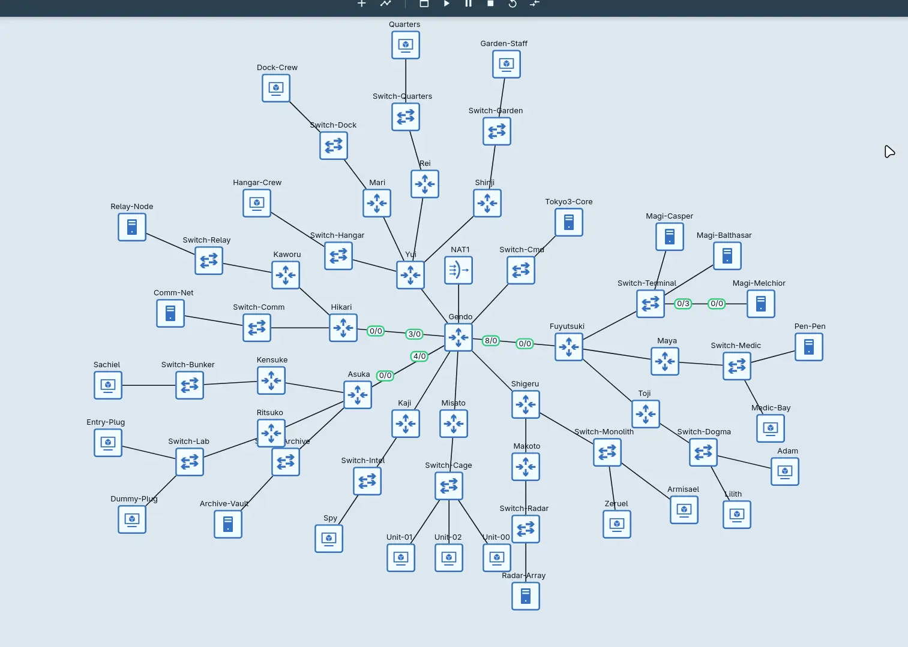

Topologi Geofront terdiri atas **60 node** (`17` router, `17` Ethernet switch, `25` container host,
dan `1` `NAT1`) dengan **59 link** (`docs/cables.csv`). Pembagian image Docker:

- `ardhptr21/debinet:latest` (**23 node**): seluruh `17` router + `Magi-Casper`, `Magi-Balthasar`,
  `Magi-Melchior`, `Pen-Pen`, `Tokyo3-Core`, dan `Zeruel`.
- `ardhptr21/alpinet:latest` (**19 node**): seluruh `19` host klien lainnya.

> Catatan konsistensi penamaan: diagram `topo_5.png` dan tabel peran menulis `Gendou`, sedangkan
> teks soal, Tabel Host, dan nama file `gendo.sh` memakai `Gendo`. Laporan dan konfigurasi memakai
> `Gendo` secara konsisten.

---

## Babak 1: Membangun Geofront

### Soal 1: Markas Tanpa Peta (VLSM & Pohon Pembagian IP)

Prefix induk kelompok K-11 adalah `10.69.0.0/21` (`2.048` alamat, blok terkecil yang menampung total
`1.196` alamat alokasi untuk `17 LAN` dan `16 link antar-router`).

- **Artefak terkait:**
    - Spreadsheet VLSM:
      [Spreadsheet_Modul_5_Komdat_Jarkom_2026_VLSM_K11.xlsx](Spreadsheet_Modul_5_Komdat_Jarkom_2026_VLSM_K11.xlsx)
    - Peta alamat & interface lengkap: [docs/alamat.md](docs/alamat.md)
    - Tabel routing statis & ringkasan CIDR: [docs/routing.md](docs/routing.md)
    - Daftar kabel GNS3 (59 link): [docs/cables.csv](docs/cables.csv)

#### Tabel Pembagian IP VLSM (17 LAN & 16 Link Antar-Router)

Urutan mengikuti kebutuhan ukuran blok terbesar ke terkecil, dengan _tie-break_ LAN sebelum link dan
urutan Tabel Host; 16 link `/30` dikelompokkan berjajar per cabang agar ringkasan CIDR pada `Gendo`
optimal.

| ID    | Jenis | Segmen                                         | Network       | Prefix | Gateway       | Broadcast     | IP Terpakai | Sisa |
| ----- | ----- | ---------------------------------------------- | ------------- | ------ | ------------- | ------------- | ----------: | ---: |
| `L1`  | LAN   | Switch-Quarters (`Rei`)                        | `10.69.0.0`   | `/23`  | `10.69.0.1`   | `10.69.1.255` |         501 |    9 |
| `L2`  | LAN   | Switch-Comm (`Hikari`)                         | `10.69.2.0`   | `/24`  | `10.69.2.1`   | `10.69.2.255` |         201 |   53 |
| `L3`  | LAN   | Switch-Hangar (`Yui`)                          | `10.69.3.0`   | `/25`  | `10.69.3.1`   | `10.69.3.127` |         101 |   25 |
| `L4`  | LAN   | Switch-Bunker (`Kensuke`)                      | `10.69.3.128` | `/26`  | `10.69.3.129` | `10.69.3.191` |          56 |    6 |
| `L5`  | LAN   | Switch-Medic (`Maya`)                          | `10.69.3.192` | `/27`  | `10.69.3.193` | `10.69.3.223` |          27 |    3 |
| `L6`  | LAN   | Switch-Relay (`Kaworu`)                        | `10.69.3.224` | `/27`  | `10.69.3.225` | `10.69.3.255` |          26 |    4 |
| `L7`  | LAN   | Switch-Garden (`Shinji`)                       | `10.69.4.0`   | `/27`  | `10.69.4.1`   | `10.69.4.31`  |          15 |   15 |
| `L8`  | LAN   | Switch-Dock (`Mari`)                           | `10.69.4.32`  | `/28`  | `10.69.4.33`  | `10.69.4.47`  |          13 |    1 |
| `L9`  | LAN   | **Switch-Lab (`Ritsuko`)** _(dilingkari)_      | `10.69.4.48`  | `/29`  | `10.69.4.49`  | `10.69.4.55`  |           6 |    0 |
| `L10` | LAN   | Switch-Terminal (`Fuyutsuki`)                  | `10.69.4.56`  | `/29`  | `10.69.4.57`  | `10.69.4.63`  |           4 |    2 |
| `L11` | LAN   | Switch-Cage (`Misato`)                         | `10.69.4.64`  | `/29`  | `10.69.4.65`  | `10.69.4.71`  |           4 |    2 |
| `L12` | LAN   | Switch-Dogma (`Toji`)                          | `10.69.4.72`  | `/29`  | `10.69.4.73`  | `10.69.4.79`  |           3 |    3 |
| `L13` | LAN   | **Switch-Monolith (`Shigeru`)** _(dilingkari)_ | `10.69.4.80`  | `/29`  | `10.69.4.81`  | `10.69.4.87`  |           3 |    3 |
| `L14` | LAN   | Switch-Radar (`Makoto`)                        | `10.69.4.88`  | `/29`  | `10.69.4.89`  | `10.69.4.95`  |           5 |    1 |
| `L15` | LAN   | Switch-Archive (`Asuka`)                       | `10.69.4.96`  | `/30`  | `10.69.4.97`  | `10.69.4.99`  |           2 |    0 |
| `L16` | LAN   | Switch-Intel (`Kaji`)                          | `10.69.4.100` | `/30`  | `10.69.4.101` | `10.69.4.103` |           2 |    0 |
| `L17` | LAN   | Switch-Cmd (`Gendo`)                           | `10.69.4.104` | `/30`  | `10.69.4.105` | `10.69.4.107` |           2 |    0 |
| `K1`  | Link  | Gendo – Yui                                    | `10.69.4.108` | `/30`  | `10.69.4.109` | `10.69.4.111` |           2 |    0 |
| `K2`  | Link  | Asuka – Kensuke                                | `10.69.4.112` | `/30`  | `10.69.4.113` | `10.69.4.115` |           2 |    0 |
| `K3`  | Link  | **Asuka – Ritsuko** _(dilingkari)_             | `10.69.4.116` | `/30`  | `10.69.4.117` | `10.69.4.119` |           2 |    0 |
| `K4`  | Link  | Fuyutsuki – Maya                               | `10.69.4.120` | `/30`  | `10.69.4.121` | `10.69.4.123` |           2 |    0 |
| `K5`  | Link  | Fuyutsuki – Toji                               | `10.69.4.124` | `/30`  | `10.69.4.125` | `10.69.4.127` |           2 |    0 |
| `K6`  | Link  | Yui – Rei                                      | `10.69.4.128` | `/30`  | `10.69.4.129` | `10.69.4.131` |           2 |    0 |
| `K7`  | Link  | Yui – Shinji                                   | `10.69.4.132` | `/30`  | `10.69.4.133` | `10.69.4.135` |           2 |    0 |
| `K8`  | Link  | Yui – Mari                                     | `10.69.4.136` | `/30`  | `10.69.4.137` | `10.69.4.139` |           2 |    0 |
| `K9`  | Link  | Hikari – Kaworu                                | `10.69.4.140` | `/30`  | `10.69.4.141` | `10.69.4.143` |           2 |    0 |
| `K10` | Link  | Shigeru – Makoto                               | `10.69.4.144` | `/30`  | `10.69.4.145` | `10.69.4.147` |           2 |    0 |
| `K11` | Link  | Gendo – Hikari                                 | `10.69.4.148` | `/30`  | `10.69.4.149` | `10.69.4.151` |           2 |    0 |
| `K12` | Link  | **Gendo – Asuka** _(dilingkari)_               | `10.69.4.152` | `/30`  | `10.69.4.153` | `10.69.4.155` |           2 |    0 |
| `K13` | Link  | Gendo – Kaji                                   | `10.69.4.156` | `/30`  | `10.69.4.157` | `10.69.4.159` |           2 |    0 |
| `K14` | Link  | Gendo – Misato                                 | `10.69.4.160` | `/30`  | `10.69.4.161` | `10.69.4.163` |           2 |    0 |
| `K15` | Link  | **Gendo – Shigeru** _(dilingkari)_             | `10.69.4.164` | `/30`  | `10.69.4.165` | `10.69.4.167` |           2 |    0 |
| `K16` | Link  | Gendo – Fuyutsuki                              | `10.69.4.168` | `/30`  | `10.69.4.169` | `10.69.4.171` |           2 |    0 |

Total blok bebas (`852` alamat): `10.69.4.172/30` (`4`), `10.69.4.176/28` (`16`), `10.69.4.192/26`
(`64`), `10.69.5.0/24` (`256`), dan `10.69.6.0/23` (`512`).

#### Alamat Host Non-Router (25 Container)

> Pada `Switch-Medic`, penomoran mengikuti urutan eksplisit Tabel Host (`1. Pen-Pen`,
> `2. Medic-Bay`), karena pada `topo_5.png` posisi `Medic-Bay` sedikit lebih kiri dibanding
> `Pen-Pen`. Pada lima switch multi-host lainnya, urutan Tabel Host dan kiri-ke-kanan gambar sudah
> identik.

| Subnet | Switch          | Gateway       | Host & Alamat IP                                                                                       |
| ------ | --------------- | ------------- | ------------------------------------------------------------------------------------------------------ |
| `L1`   | Switch-Quarters | `10.69.0.1`   | `Quarters` (`10.69.0.2/23`)                                                                            |
| `L2`   | Switch-Comm     | `10.69.2.1`   | `Comm-Net` (`10.69.2.2/24`)                                                                            |
| `L3`   | Switch-Hangar   | `10.69.3.1`   | `Hangar-Crew` (`10.69.3.2/25`)                                                                         |
| `L4`   | Switch-Bunker   | `10.69.3.129` | `Sachiel` (`10.69.3.130/26`)                                                                           |
| `L5`   | Switch-Medic    | `10.69.3.193` | `Pen-Pen` (`10.69.3.194/27`), `Medic-Bay` (`10.69.3.195/27`)                                           |
| `L6`   | Switch-Relay    | `10.69.3.225` | `Relay-Node` (`10.69.3.226/27`)                                                                        |
| `L7`   | Switch-Garden   | `10.69.4.1`   | `Garden-Staff` (`10.69.4.2/27`)                                                                        |
| `L8`   | Switch-Dock     | `10.69.4.33`  | `Dock-Crew` (`10.69.4.34/28`)                                                                          |
| `L9`   | Switch-Lab      | `10.69.4.49`  | `Entry-Plug` (`10.69.4.50/29`), `Dummy-Plug` (`10.69.4.51/29`)                                         |
| `L10`  | Switch-Terminal | `10.69.4.57`  | `Magi-Casper` (`10.69.4.58/29`), `Magi-Balthasar` (`10.69.4.59/29`), `Magi-Melchior` (`10.69.4.60/29`) |
| `L11`  | Switch-Cage     | `10.69.4.65`  | `Unit-01` (`10.69.4.66/29`), `Unit-02` (`10.69.4.67/29`), `Unit-00` (`10.69.4.68/29`)                  |
| `L12`  | Switch-Dogma    | `10.69.4.73`  | `Lilith` (`10.69.4.74/29`), `Adam` (`10.69.4.75/29`)                                                   |
| `L13`  | Switch-Monolith | `10.69.4.81`  | `Zeruel` (`10.69.4.82/29`), `Armisael` (`10.69.4.83/29`)                                               |
| `L14`  | Switch-Radar    | `10.69.4.89`  | `Radar-Array` (`10.69.4.90/29`)                                                                        |
| `L15`  | Switch-Archive  | `10.69.4.97`  | `Archive-Vault` (`10.69.4.98/30`)                                                                      |
| `L16`  | Switch-Intel    | `10.69.4.101` | `Spy` (`10.69.4.102/30`)                                                                               |
| `L17`  | Switch-Cmd      | `10.69.4.105` | `Tokyo3-Core` (`10.69.4.106/30`)                                                                       |

#### Gambar Pohon Pembagian IP


Sumber diagram: [vlsm-tree.dot](docs/images/vlsm-tree.dot) ([SVG](docs/images/vlsm-tree.svg)). Lima
subnet pada jalur **Dummy-Plug ke Armisael** yang dilingkari oval merah tebal adalah:

1. `L9` (`10.69.4.48/29`) - `Switch-Lab` (`Dummy-Plug` di `10.69.4.51` menuju gateway `Ritsuko` di
   `10.69.4.49`)
2. `K3` (`10.69.4.116/30`) - Link `Ritsuko` (`10.69.4.118`) ↔ `Asuka` (`10.69.4.117`)
3. `K12` (`10.69.4.152/30`) - Link `Asuka` (`10.69.4.154`) ↔ `Gendo` (`10.69.4.153`)
4. `K15` (`10.69.4.164/30`) - Link `Gendo` (`10.69.4.165`) ↔ `Shigeru` (`10.69.4.166`)
5. `L13` (`10.69.4.80/29`) - `Switch-Monolith` (gateway `Shigeru` di `10.69.4.81` menuju `Armisael`
   di `10.69.4.83`)

#### Penjelasan Hitungan Satu Subnet: `L7` (`Switch-Garden` - `10.69.4.0/27`)

1. **Menentukan kebutuhan alamat usable:** pada Tabel Host, `Garden-Staff` membutuhkan `14` host,
   ditambah `1` alamat untuk gateway router `Shinji`, sehingga total IP usable yang dibutuhkan
   adalah $14 + 1 = 15$.
2. **Memilih prefix terkecil yang muat:** jumlah IP usable untuk $h$ bit host adalah $2^h - 2$.
    - Jika memakai $h = 4$ (`/28`), kapasitas usable hanya $2^4 - 2 = 14$ (kurang `1` alamat karena
      gateway ikut dihitung).
    - Maka dipilih $h = 5$, menghasilkan kapasitas usable $2^5 - 2 = 30 \ge 15$, dengan ukuran blok
      $2^5 = 32$ alamat dan prefix $32 - 5 = /27$ (`255.255.255.224`).
3. **Menentukan alamat awal (Network ID):** enam subnet sebelumnya (`L1`–`L6`) menempati blok secara
   berurutan dari `10.69.0.0` hingga `10.69.3.255` (`512 + 256 + 128 + 64 + 32 + 32 = 1.024`
   alamat). Alamat kosong berikutnya adalah `10.69.4.0`, yang kelipatan `32` ($0 \bmod 32 = 0$),
   sehingga Network ID `L7` adalah `10.69.4.0/27`.
4. **Menentukan batas alamat dan sisa:**
    - **Network ID:** `10.69.4.0`
    - **Gateway (`Shinji`, usable pertama):** `10.69.4.1`
    - **Container `Garden-Staff` (usable kedua):** `10.69.4.2` (mencadangkan 14 alamat grup host
      hingga `10.69.4.15`)
    - **Rentang usable:** `10.69.4.1 - 10.69.4.30`
    - **Broadcast:** `10.69.4.0 + 32 - 1 = 10.69.4.31`
    - **IP terpakai / Sisa:** `15` terpakai (`14` host + `1` gateway), sisa $30 - 15 = 15$ IP
      usable.

---

### Soal 2: Geofront Gelap Gulita (Interface Router & IP Forwarding)

Topologi `60` node dan `59` kabel dibangun pada project GNS3 `K-11-MODUL-5` melalui
[build_topology.py](tools/build_topology.py). Setiap router memperoleh konfigurasi
`/etc/network/interfaces` sesuai [docs/alamat.md](docs/alamat.md) dan IPv4 forwarding
(`net.ipv4.ip_forward = 1`). Hanya `Gendo` (`eth0`) yang tersambung ke `NAT1` melalui DHCP
(`192.168.122.82/24`).

Bukti lengkap seluruh `17` router (`ip -br a`, `ip_forward = 1`) serta uji ping dua arah (`32` arah
pada `16` link router-ke-router): [evidence/babak1/soal2.txt](evidence/babak1/soal2.txt).

```text
--- Gendo (dijalankan di Gendo) ---
lo               UNKNOWN        127.0.0.1/8 ::1/128
eth0             UNKNOWN        192.168.122.82/24
eth1             UNKNOWN        10.69.4.105/30
eth2             UNKNOWN        10.69.4.109/30
eth3             UNKNOWN        10.69.4.149/30
eth4             UNKNOWN        10.69.4.153/30
eth5             UNKNOWN        10.69.4.157/30
eth6             UNKNOWN        10.69.4.161/30
eth7             UNKNOWN        10.69.4.165/30
eth8             UNKNOWN        10.69.4.169/30
net.ipv4.ip_forward = 1
```

Seluruh `32` ping ujung-ke-ujung link `K1`–`K16` tercatat `0% packet loss`.

```sh
# dijalankan di Gendo (dan router lain)
ip -br a
sysctl net.ipv4.ip_forward

# contoh uji dua ujung link K15 (Gendo <-> Shigeru)
# dijalankan di Gendo
ping -c 2 10.69.4.166
# dijalankan di Shigeru
ping -c 2 10.69.4.165
```

 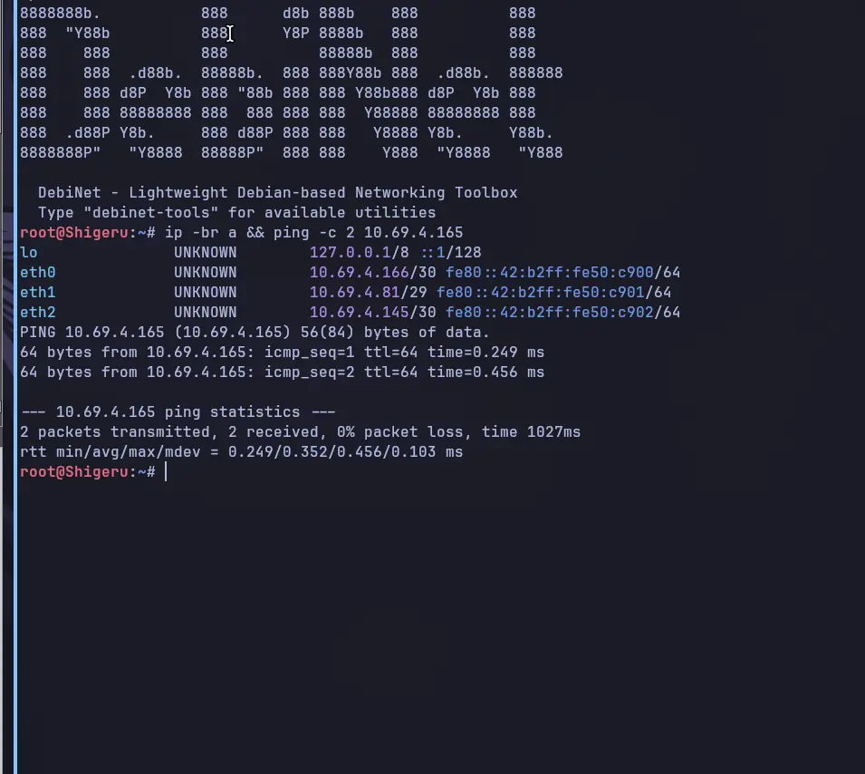

---

### Soal 3: Pulau-Pulau yang Terpisah (Routing Statis & Ringkasan CIDR)

Setiap router dikonfigurasi dengan script idempoten (`/root/<nama>.sh`, cadangan di
[script/](script/)) memakai `ip route replace`. Router di bawah `Gendo` memakai `default` ke router
induk + rute spesifik LAN anak, sedangkan `Gendo` memakai `default` via `NAT1` (`eth0`) dan `21`
rute cabang hasil `4` ringkasan CIDR eksak (`10.69.4.80/28`, `10.69.4.112/29`, `10.69.4.120/29`,
`10.69.4.128/29`). Rincian lengkap: [docs/routing.md](docs/routing.md) dan
[evidence/babak1/soal3.txt](evidence/babak1/soal3.txt).

Uji sementara dari `Armisael` (`10.69.4.83`) ke tiga cabang berbeda berhasil (`0% packet loss`):

- `ping -c 3 10.69.4.74` (`Lilith`): `3 transmitted, 3 received, 0% packet loss`
- `ping -c 3 10.69.3.130` (`Sachiel`): `3 transmitted, 3 received, 0% packet loss`
- `ping -c 3 10.69.2.2` (`Comm-Net`): `3 transmitted, 3 received, 0% packet loss`

```sh
# dijalankan di Gendo
ip route

# dijalankan di Armisael (ping ke Lilith, Sachiel, Comm-Net)
ping -c 3 10.69.4.74
ping -c 3 10.69.3.130
ping -c 3 10.69.2.2
```

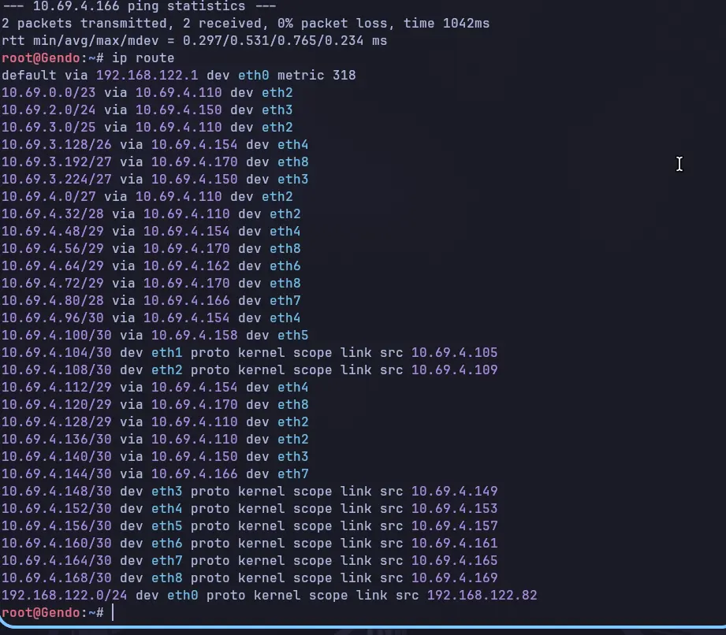 

---

### Soal 4: Haus Kabar dari Dunia Luar (NAT Dinamis & DNS)

Pada `Gendo` ([script/gendo.sh](script/gendo.sh)), ditambahkan NAT dinamis (`MASQUERADE`) berbasis
interface keluar `eth0` dan prefix internal `10.69.0.0/21` sehingga konfigurasi tidak bergantung
pada IP DHCP `NAT1` yang bisa berubah, sementara traffic antar-LAN tetap memakai IP asli
pengirimnya:

```sh
iptables -t nat -C POSTROUTING -s 10.69.0.0/21 -o eth0 -j MASQUERADE 2>/dev/null || \
  iptables -t nat -A POSTROUTING -s 10.69.0.0/21 -o eth0 -j MASQUERADE
```

Bukti di [evidence/babak1/soal4.txt](evidence/babak1/soal4.txt):

- Ping antar-LAN `Armisael` → `Lilith` (`10.69.4.74`) **tidak** menaikkan counter `MASQUERADE`
  (`0 packets`).
- `Armisael` dan `Lilith` berhasil `ping -c 3 8.8.8.8` dan `ping -c 3 deb.debian.org`
  (`0% packet loss`), dan counter `MASQUERADE` di `Gendo` naik menjadi `12 pkts / 868 bytes`.

```sh
# dijalankan di Armisael
ping -c 3 8.8.8.8
ping -c 3 deb.debian.org

# dijalankan di Lilith
ping -c 3 8.8.8.8
ping -c 3 deb.debian.org

# dijalankan di Gendo (cek counter rule NAT)
iptables -t nat -L POSTROUTING -v -n
```

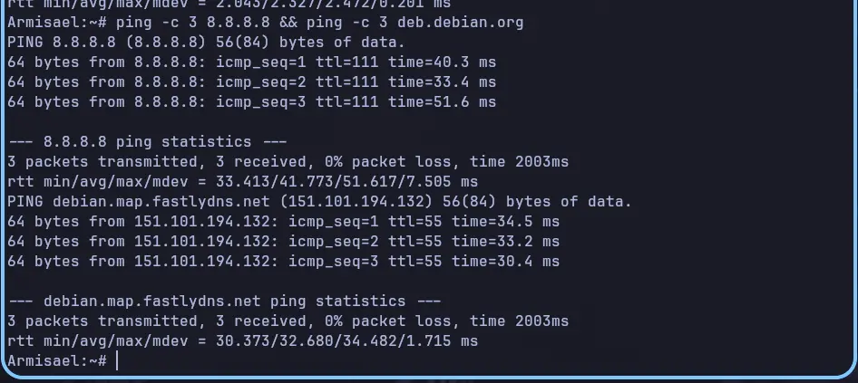 

---

### Soal 5: Pintu Depan Dikunci Rapat (Lockdown `Gendo`)

Seluruh aturan Soal 2–5 digabung secara idempoten di `/root/gendo.sh`
([script/gendo.sh](script/gendo.sh)): policy `INPUT` dan `FORWARD` diubah ke `DROP` setelah
mengizinkan `lo`, `ESTABLISHED,RELATED`, DHCP dari `NAT1` (`eth0` UDP `67 -> 68`), serta traffic
`10.69.0.0/21` (`! -i eth0`) untuk internet (`-o eth0`), antar-LAN (`! -o eth0`), dan ke `Gendo`
sendiri.

```text
--- iptables -S @ Gendo ---
-P INPUT DROP
-P FORWARD DROP
-P OUTPUT ACCEPT
-A INPUT -i lo -j ACCEPT
-A INPUT -m conntrack --ctstate RELATED,ESTABLISHED -j ACCEPT
-A INPUT -i eth0 -p udp -m udp --sport 67 --dport 68 -j ACCEPT
-A INPUT -s 10.69.0.0/21 ! -i eth0 -j ACCEPT
-A FORWARD -m conntrack --ctstate RELATED,ESTABLISHED -j ACCEPT
-A FORWARD -s 10.69.0.0/21 ! -i eth0 -o eth0 -j ACCEPT
-A FORWARD -s 10.69.0.0/21 -d 10.69.0.0/21 ! -i eth0 ! -o eth0 -j ACCEPT
```

Bukti di [evidence/babak1/soal5.txt](evidence/babak1/soal5.txt):

- Menjalankan `bash /root/gendo.sh` dua kali berturut-turut menghasilkan rule identik (`10` baris
  `filter`, `5` baris `nat`).
- `Armisael` tetap berhasil ping ke `8.8.8.8`, `Lilith` (`10.69.4.74`), dan `Gendo` (`10.69.4.165`),
  sementara ping baru dari sisi `NAT1` (`virbr0` → `192.168.122.82`) ditolak (`100% packet loss`).

```sh
# dijalankan di Gendo
iptables -S
iptables -t nat -S

# cek idempoten 2x eksekusi
bash /root/gendo.sh && iptables -S | wc -l && iptables -t nat -S | wc -l
bash /root/gendo.sh && iptables -S | wc -l && iptables -t nat -S | wc -l

# dijalankan di Armisael
ping -c 3 8.8.8.8
ping -c 2 10.69.4.74
ping -c 2 10.69.4.165
```

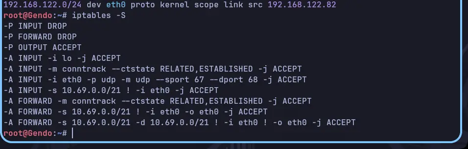

---

### Soal 6: Alamat Para Pilot (IP Statis Permanen 25 Host)

Seluruh `25` host non-router dikonfigurasi permanen melalui `/etc/network/interfaces` dan
`/root/init.sh` (resolver DNS saat boot). `Unit-01` di-restart penuh (`stop` + `start`) untuk
memverifikasi persistensi:

```text
--- Unit-01 (dijalankan di Unit-01 setelah restart) ---
lo               UNKNOWN        127.0.0.1/8 ::1/128
eth0             UNKNOWN        10.69.4.66/29
default via 10.69.4.65 dev eth0
PING 10.69.4.65: 3 packets transmitted, 3 received, 0% packet loss
```

Seluruh `25` host lolos uji IP, gateway, dan `8.8.8.8` di
[evidence/babak1/soal6.txt](evidence/babak1/soal6.txt).

```sh
# dijalankan di Unit-01 (setelah stop + start)
ip -br a
ip route
cat /etc/network/interfaces
ping -c 3 10.69.4.65
ping -c 2 8.8.8.8
```

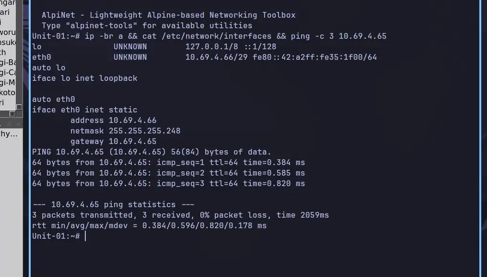

---

### Soal 7: Membangunkan MAGI

Paket `iptables` dan `netcat-traditional` dipasang lewat script idempoten
[script/magi-casper.sh](script/magi-casper.sh),
[script/magi-balthasar.sh](script/magi-balthasar.sh), dan
[script/magi-melchior.sh](script/magi-melchior.sh) (`/root/<nama>.sh`), serta menjalankan listener
TCP `nc.traditional`:

- `Magi-Casper` (`10.69.4.58`): TCP `5000`
- `Magi-Balthasar` (`10.69.4.59`): TCP `5000` dan `5001`
- `Magi-Melchior` (`10.69.4.60`): TCP `5000`

Uji kirim `nc -N -w 2` dari `Lilith` (`10.69.4.74`) ke keempat port keluar dengan `exit=0`, dan
seluruh pesan tercatat di `/var/log/magi-<port>.log` masing-masing node
([evidence/babak1/soal7.txt](evidence/babak1/soal7.txt)).

```sh
# dijalankan di Lilith
echo "tes casper" | nc -N -w 2 10.69.4.58 5000
echo "tes balthasar 5000" | nc -N -w 2 10.69.4.59 5000
echo "tes balthasar 5001" | nc -N -w 2 10.69.4.59 5001
echo "tes melchior" | nc -N -w 2 10.69.4.60 5000

# dijalankan di Magi-Casper
ss -tlnp && cat /var/log/magi-5000.log

# dijalankan di Magi-Balthasar
ss -tlnp && cat /var/log/magi-5000.log && echo "---" && cat /var/log/magi-5001.log

# dijalankan di Magi-Melchior
ss -tlnp && cat /var/log/magi-5000.log
```

 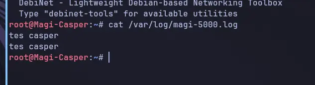 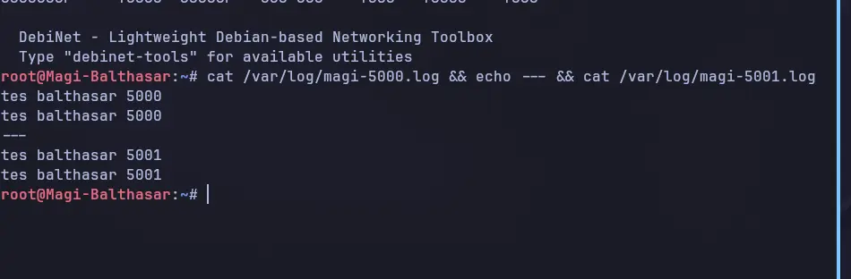


---

### Soal 8: Mengenali Kondisi Normal (`Pen-Pen` & `Tokyo3-Core`)

Responder `nc.traditional` dipasang via [script/pen-pen.sh](script/pen-pen.sh) dan
[script/tokyo3-core.sh](script/tokyo3-core.sh):

- `Pen-Pen` (`10.69.3.194:80`) → `Welcome to Pen-Pen`
- `Tokyo3-Core` (`10.69.4.106:80`) → `Welcome to Tokyo3-Core`
- `Tokyo3-Core` (`10.69.4.106:8080`) → `syifa imutz`

Uji dari `Lilith` dua kali per port mengembalikan banner yang tepat, dan probe ke port tertutup `22`
(`nc -zv -w 3`) langsung gagal dalam `0.058s` (`Connection refused`, bukan menggantung hingga
timeout): [evidence/babak1/soal8.txt](evidence/babak1/soal8.txt).

```sh
# dijalankan di Lilith
nc -w 2 10.69.3.194 80 </dev/null
nc -w 2 10.69.4.106 80 </dev/null
nc -w 2 10.69.4.106 8080 </dev/null
time nc -zv -w 3 10.69.3.194 22
time nc -zv -w 3 10.69.4.106 22
```

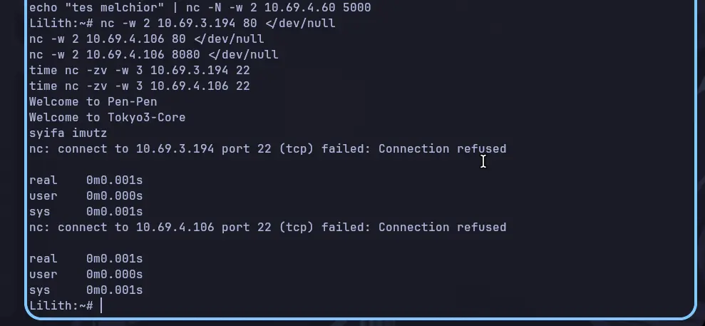

---

## Babak 2: Sabotase dan Hantu MAGI

Seluruh script sabotase (`break_routing.sh`, `break_nat.sh`, `break_fw.sh`) diunduh langsung dan
dijalankan di dalam container target tanpa membaca isi scriptnya; diagnosa dilakukan murni dari
selisih (_diff_) kondisi kernel dan gejala jaringan ([evidence/babak2/](evidence/babak2/)).

### Soal 9: Jalur Belakang Diutak-atik (`break_routing.sh` di `Shigeru`)

**Penyebab yang ditemukan:**

1. **`net.ipv4.ip_forward` dinonaktifkan menjadi `0`** (termasuk `conf.*.forwarding = 0`), sehingga
   `Shigeru` berhenti meneruskan paket antar-interface.
2. **Default route dibelokkan ke router anak `Makoto`** (`default via 10.69.4.146 dev eth2`), bukan
   ke upstream `Gendo` (`10.69.4.165 dev eth0`).
3. **Rute `blackhole 10.69.4.72/29`** ditambahkan di tabel `main`, menjatuhkan seluruh traffic
   menuju `Switch-Dogma` (`Lilith`).
4. **Policy routing rule `90: from all iif eth1 lookup 100` dengan isi
   `unreachable default table 100`** menangkap seluruh paket yang masuk dari `Switch-Monolith`
   (`Armisael`) sebelum sempat memakai tabel `main`.

**Penjelasan gejala:**

- `Armisael` tetap bisa ping gateway-nya sendiri (`10.69.4.81`) karena paket ditujukan ke alamat
  lokal router (`table local` prioritas `0` berada di atas aturan `90`) dan tidak memerlukan
  `ip_forward = 1`.
- `Lilith` tidak mendapat jawaban dari `Armisael` karena forwarding mati (`ip_forward = 0`), paket
  balasan dari `Armisael` di `eth1` langsung ditolak oleh `rule 90 -> table 100 unreachable`, dan
  rute balik ke `10.69.4.72/29` terkena `blackhole`.

**Perbaikan (`Shigeru`):**

```sh
ip route del blackhole 10.69.4.72/29
ip rule del pref 90
ip route flush table 100
bash /root/shigeru.sh   # mengembalikan ip_forward=1, default via 10.69.4.165 dev eth0, dan rute 10.69.4.88/29
```

**Bukti verifikasi ([evidence/babak2/soal9.txt](evidence/babak2/soal9.txt)):**

- `Lilith` → `Armisael` (`10.69.4.83`): `3 transmitted, 3 received, 0% packet loss`.
- `Armisael` → `Lilith` (`10.69.4.74`) dan `8.8.8.8`: `0% packet loss`.

```sh
# dijalankan di Shigeru
ip route show table all
ip rule list
sysctl net.ipv4.ip_forward

# dijalankan di Lilith
ping -c 3 10.69.4.83

# dijalankan di Armisael (dan Radar-Array)
ping -c 3 10.69.4.74
ping -c 3 8.8.8.8
```

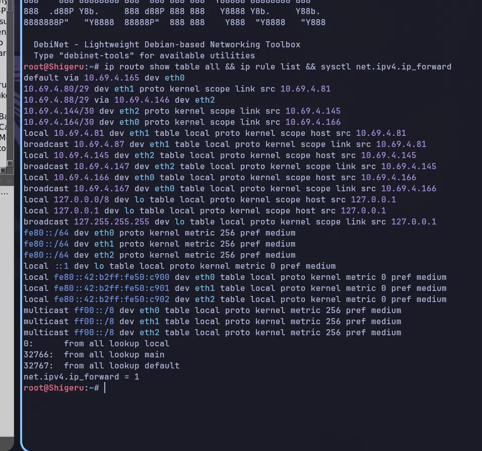 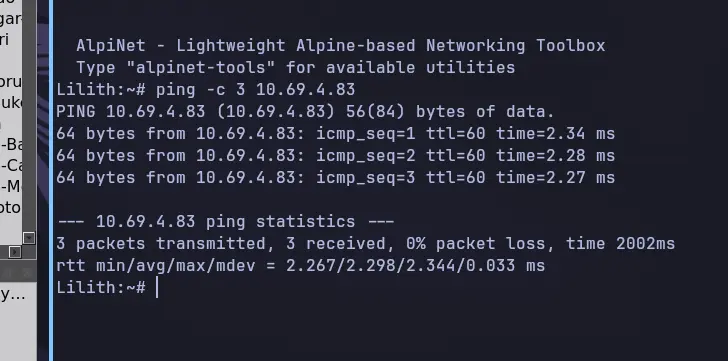

---

### Soal 10: Para Pilot Terkunci di Dalam (`break_nat.sh` di `Misato` & `Gendo`)

**Dua penyebab yang ditemukan:**

1. **Di `Misato` (tabel `nat` `POSTROUTING`):** ditambahkan rule:
    ```text
    -A POSTROUTING -s 10.69.4.64/29 ! -d 10.69.0.0/16 -o eth0 -j SNAT --to-source 172.31.99.1
    ```
    Untuk tujuan non-internal (internet `8.8.8.8`), alamat sumber `Switch-Cage` (`10.69.4.64/29`)
    diterjemahkan lebih dulu oleh `Misato` menjadi `172.31.99.1`, sehingga di `Gendo` paket tersebut
    tidak cocok dengan aturan `FORWARD` maupun `MASQUERADE` `10.69.0.0/21` dan langsung di-`DROP`.
2. **Di `Gendo` (tabel `nat` `POSTROUTING`):** disisipkan rule di atas `MASQUERADE`:
    ```text
    -A POSTROUTING -s 10.69.4.64/29 -o eth0 -j RETURN
    ```
    Jika hanya `Misato` yang dibersihkan, paket `Switch-Cage` keluar ke `NAT1` tanpa NAT karena
    `RETURN` menghentikan evaluasi chain `POSTROUTING` sebelum rule `MASQUERADE`.

**Jawaban pertanyaan analisis:**

- **Mengapa `Switch-Cage` terdampak tetapi `Switch-Intel` (`Spy`) tidak:** kedua rule sabotase
  menyasar spesifik prefix `10.69.4.64/29` (`Switch-Cage` di bawah `Misato`), sedangkan `Spy` berada
  pada `10.69.4.100/30` di bawah `Kaji`. Sementara `Cage -> Lilith` (`10.69.4.74`) tetap normal
  karena tujuan masih berada di dalam `10.69.0.0/16` (`! -d 10.69.0.0/16` tidak cocok).
- **Di router mana alamat sumber diterjemahkan:** saat sabotase aktif ke internet, alamat sumber
  diterjemahkan lebih dulu di **`Misato`** menjadi `172.31.99.1`; dalam kondisi normal setelah
  perbaikan, terjemahan alamat sumber (`MASQUERADE`) hanya terjadi di router tepi **`Gendo`**
  (`eth0` menuju `NAT1`).

**Perbaikan (`Misato` & `Gendo`):**

```sh
# Dijalankan di Misato
iptables -t nat -D POSTROUTING -s 10.69.4.64/29 ! -d 10.69.0.0/16 -o eth0 -j SNAT --to-source 172.31.99.1

# Dijalankan di Gendo
iptables -t nat -D POSTROUTING -s 10.69.4.64/29 -o eth0 -j RETURN
bash /root/gendo.sh
```

**Bukti verifikasi ([evidence/babak2/soal10.txt](evidence/babak2/soal10.txt)):**

- `Unit-01`, `Unit-02`, `Unit-00`, `Spy`, dan `Armisael` seluruhnya berhasil `ping -c 3 8.8.8.8`
  (`0% packet loss`).

```sh
# dijalankan di Misato
iptables -t nat -S

# dijalankan di Gendo
iptables -t nat -S
iptables -S

# dijalankan di Unit-01 (dan Unit-02 / Unit-00 / Spy)
ping -c 3 8.8.8.8
ping -c 2 10.69.4.74
```

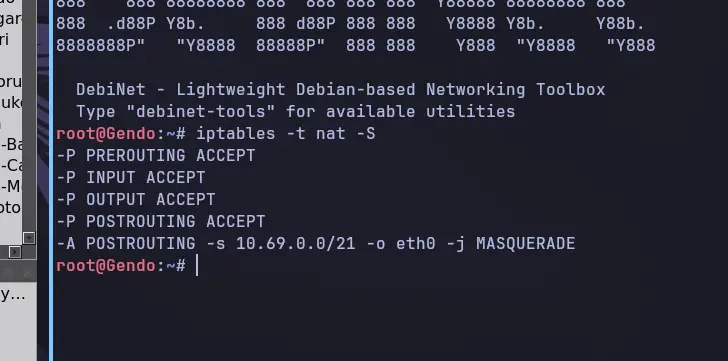 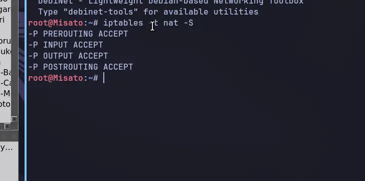 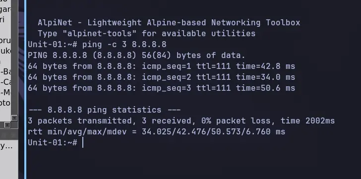

---

### Soal 11: Casper Harus Jadi Hantu (`Magi-Casper`)

Pada [script/magi-casper.sh](script/magi-casper.sh) (`/root/magi-casper.sh`), ditambahkan aturan
idempoten untuk membuang seluruh ICMP `echo-request` masuk sambil menjaga ping keluar (`echo-reply`)
dan layanan TCP `5000` tetap berjalan:

```sh
iptables -C INPUT -p icmp --icmp-type echo-request -j DROP 2>/dev/null || \
  iptables -A INPUT -p icmp --icmp-type echo-request -j DROP
```

**Bukti verifikasi ([evidence/babak2/soal11.txt](evidence/babak2/soal11.txt)):**

- `Magi-Balthasar` (`10.69.4.59`) → `ping 10.69.4.58`: `100% packet loss` (gagal, meski satu
  switch).
- `Lilith` (`10.69.4.74`) → `ping 10.69.4.58`: `100% packet loss` (gagal).
- `Magi-Casper` → `ping 10.69.4.59` (`Magi-Balthasar`) & `10.69.4.74` (`Lilith`): keduanya
  `3 received, 0% packet loss`.
- `Lilith` → `Magi-Casper:5000` (`nc -N -w 2`): `exit=0`, pesan tercatat di
  `/var/log/magi-5000.log`.

```sh
# dijalankan di Magi-Balthasar (harus gagal / 100% loss)
ping -c 2 -W 1 10.69.4.58

# dijalankan di Lilith (harus gagal / 100% loss)
ping -c 2 -W 1 10.69.4.58

# dijalankan di Magi-Casper (harus berhasil / 0% loss)
ping -c 3 10.69.4.59
ping -c 3 10.69.4.74

# dijalankan di Lilith (TCP 5000 tetap hidup)
echo "uji soal 11" | nc -N -w 2 10.69.4.58 5000
```

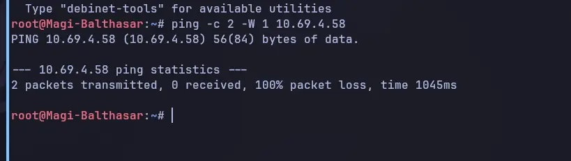 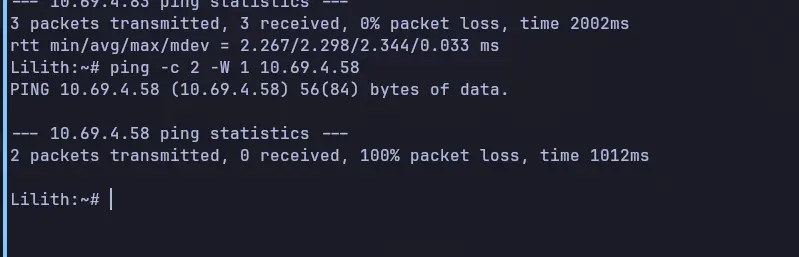 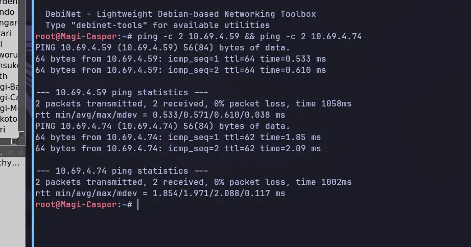

---

### Soal 12: Teknisi yang Kelewat Semangat (`break_fw.sh` di `Magi-Casper`)

**Empat penyebab yang ditemukan:**

1. **Policy `INPUT` diubah menjadi `DROP` tanpa rule `ESTABLISHED,RELATED`**, sehingga balasan ping
   `8.8.8.8` maupun balasan HTTP/DNS untuk `apt-get update` terbuang di `INPUT`.
2. **Rule `-A INPUT -p icmp -j DROP`** memblokir seluruh tipe ICMP (bukan hanya `echo-request`),
   ikut menghalangi balasan ICMP untuk ping keluar.
3. **Tidak ada rule izin masuk untuk layanan TCP port `5000`**, sehingga `Unit-00` gagal terhubung
   ke port `5000` Casper.
4. **Rule `-A OUTPUT -p udp --dport 53 -j DROP`** memblokir query DNS keluar, sehingga
   `apt-get update` gagal me-resolve `deb.debian.org`.

**Perbaikan tanpa membatalkan tujuan hardening (`Magi-Casper`,
[script/magi-casper.sh](script/magi-casper.sh)):** Menghapus dua rule sabotase
(`-D INPUT -p icmp -j DROP` dan `-D OUTPUT -p udp --dport 53 -j DROP`), lalu menerapkan policy
`INPUT DROP` dan `FORWARD DROP` dengan aturan izin minimal secara idempoten:

```text
-P INPUT DROP
-P FORWARD DROP
-P OUTPUT ACCEPT
-A INPUT -i lo -j ACCEPT
-A INPUT -m conntrack --ctstate RELATED,ESTABLISHED -j ACCEPT
-A INPUT -p tcp -m tcp --dport 5000 -j ACCEPT
-A INPUT -p icmp -m icmp --icmp-type 8 -j DROP
```

**Bukti verifikasi ([evidence/babak2/soal12.txt](evidence/babak2/soal12.txt)):**

- `Unit-00` (`10.69.4.68`) → `Magi-Casper:5000` (`nc -N -w 2 10.69.4.58 5000`): `exit=0`, pesan
  masuk ke `/var/log/magi-5000.log`.
- `apt-get update` di `Magi-Casper`: berhasil (`Hit` seluruh repositori Debian, tanpa error DNS).
- `Magi-Casper` → `ping 8.8.8.8`, `Magi-Balthasar`, `Lilith`: seluruhnya `0% packet loss`.
- Ping masuk dari `Magi-Balthasar` & `Lilith` ke `Magi-Casper` serta koneksi ke port `22` dari
  `Unit-00` tetap ditolak (`policy INPUT DROP`).

```sh
# dijalankan di Magi-Casper
iptables -S
apt-get update
ping -c 3 8.8.8.8
cat /var/log/magi-5000.log

# dijalankan di Unit-00 (5000 berhasil, 22 ditolak/timeout)
echo "uji soal 12" | nc -N -w 2 10.69.4.58 5000
nc -zv -w 2 10.69.4.58 22

# dijalankan di Magi-Balthasar / Lilith (ping masuk tetap gagal)
ping -c 2 -W 1 10.69.4.58
```

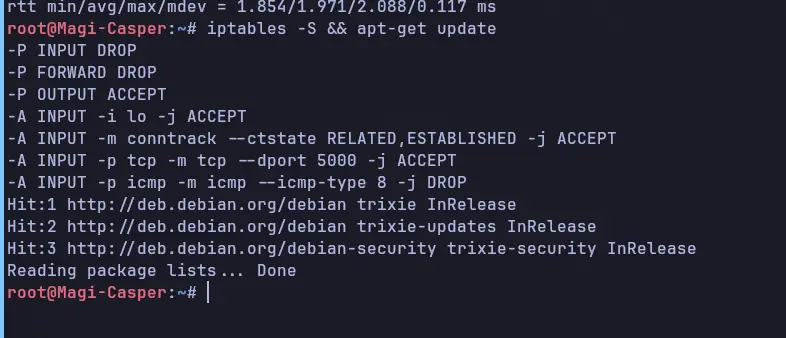 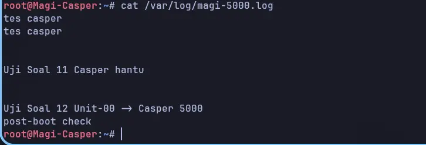 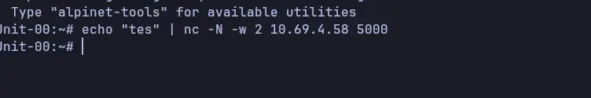
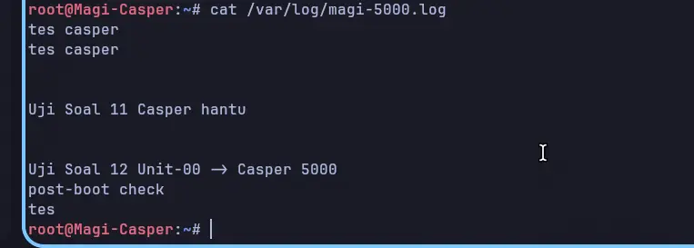

---

## Babak 3 & Final: Mengamankan Geofront dan Uji Kebakaran

Berbeda dengan Babak 1 yang membangun layanan, babak ini menambahkan lapisan pengamanan di atas
layanan yang sudah ada, lalu diakhiri uji pemulihan. Seluruh konfigurasi dikerjakan manual lewat
console GNS3 dan disimpan permanen di `/root/<nama>.sh` (cadangan di [script/](script/)), sehingga
otomatis dijalankan ulang oleh `/root/init.sh` saat boot.

Node yang tersentuh: `Magi-Balthasar` (Soal 13), `Pen-Pen` (14, 17), `Tokyo3-Core` (15, 16, 20),
`Fuyutsuki` (17, 20), `Shigeru` (18, 19, 20), serta `Armisael`, `Lilith`, dan `Zeruel` sebagai node
uji (17, 19). Karena itu seluruh script dirancang **idempoten** sejak awal - memakai
`iptables -C ... || iptables -A ...`, atau `place_rule` untuk rule yang urutannya ikut dinilai.
Sifat inilah yang diuji pada Soal 20.

### Soal 13: Kunci Layanan MAGI (`Magi-Balthasar`)

Pada [script/magi-balthasar.sh](script/magi-balthasar.sh) (`/root/magi-balthasar.sh`), listener TCP
`5000` dan `5001` dari Soal 7 dibungkus dengan whitelist: hanya lima node yang boleh menghubungi
layanan MAGI. Node lain ditolak seketika dengan `tcp-reset`, sehingga penyerang menerima
`Connection refused` alih-alih menggantung sampai timeout.

```sh
# daftar yang diizinkan, lalu tolak sisanya
for src in 10.69.4.58 10.69.4.66 10.69.4.67 10.69.4.68 10.69.3.130; do
  add_rule INPUT -s "$src" -p tcp -m multiport --dports 5000,5001 -j ACCEPT
done
add_rule INPUT -p tcp -m multiport --dports 5000,5001 -j REJECT --reject-with tcp-reset
iptables -P INPUT DROP
```

Lima node tersebut adalah `Magi-Casper` (`10.69.4.58`), `Unit-01` (`10.69.4.66`), `Unit-02`
(`10.69.4.67`), `Unit-00` (`10.69.4.68`), dan `Sachiel` (`10.69.3.130`). Rule `lo` dan
`ESTABLISHED,RELATED` tetap dipasang lebih dulu supaya balasan koneksi dan `apt-get` tidak ikut
terputus.

**Bukti verifikasi:**

- `Unit-01` → `Magi-Balthasar:5000` (`nc -N -w 2`): `exit=0`, pesan masuk `/var/log/magi-5000.log`.
- `Lilith` dan `Armisael` → `Magi-Balthasar:5000` (`nc -zv -w 3`): `Connection refused` dalam < `1`
  detik, bukan timeout.
- Menjalankan `bash /root/magi-balthasar.sh` dua kali berturut-turut: `iptables -S` identik
  (`IDEMPOTEN`).

```sh
# dijalankan di Magi-Balthasar
iptables -S
ss -tlnp

# dijalankan di Unit-01 (host yang diizinkan)
printf 'tes13 dari Unit-01\n' | nc -N -w 2 10.69.4.59 5000; echo "exit=$?"

# dijalankan di Lilith (host yang dilarang)
time nc -zv -w 3 10.69.4.59 5000

# uji idempoten
iptables -S > /tmp/a; bash /root/magi-balthasar.sh; iptables -S > /tmp/b
diff /tmp/a /tmp/b && echo "IDEMPOTEN"
```

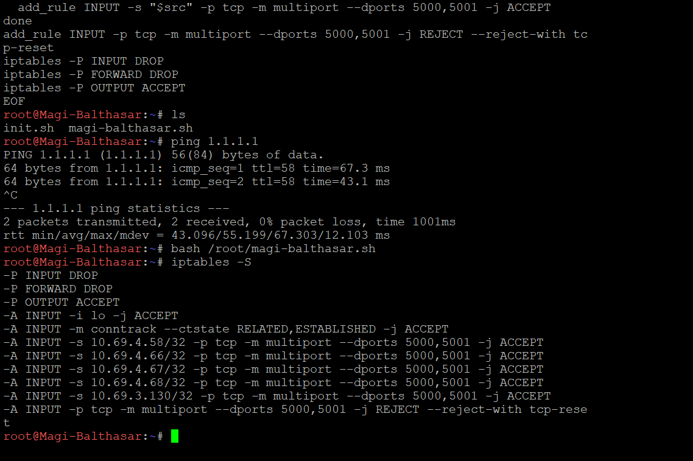 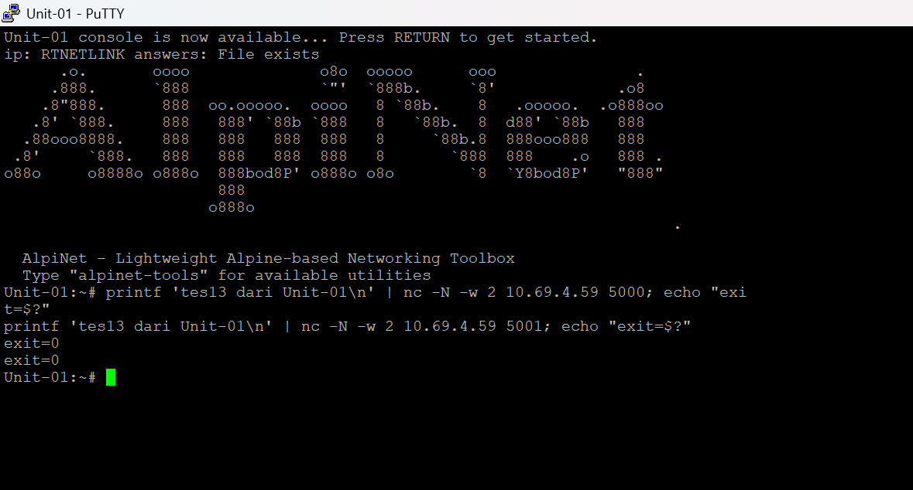
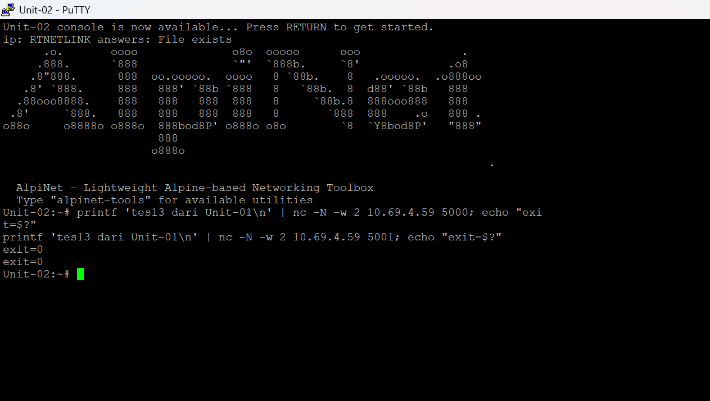
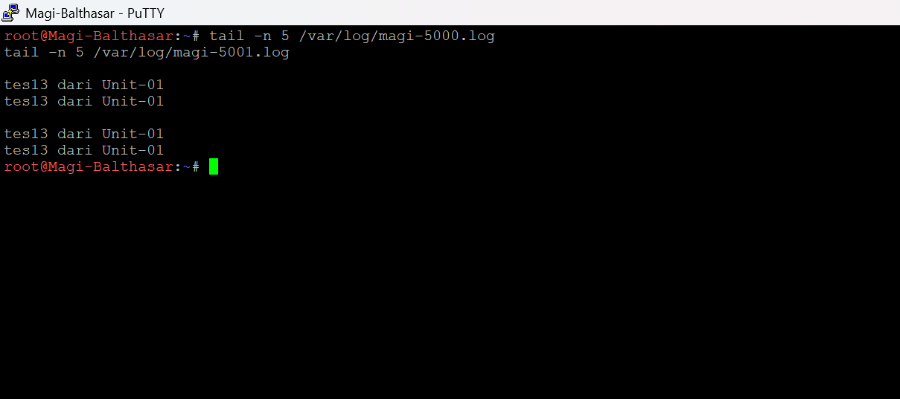
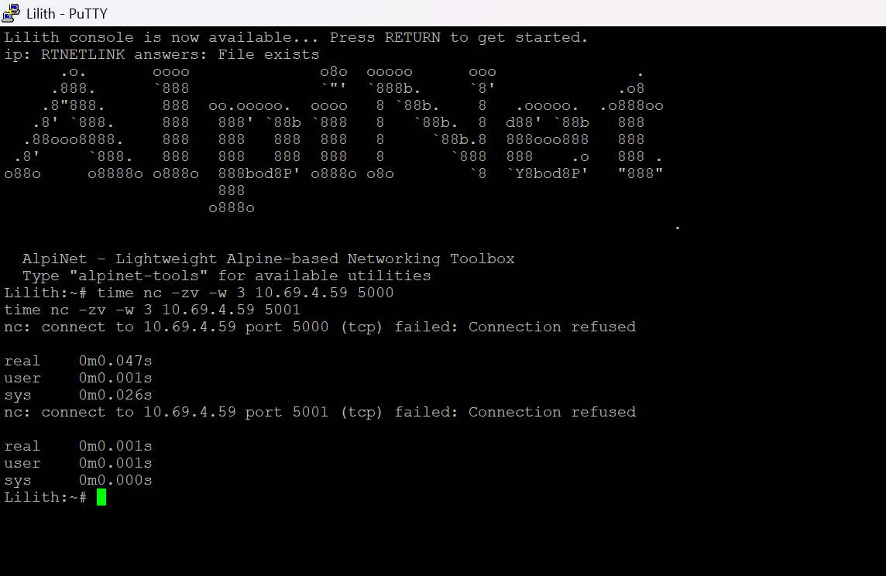

---

### Soal 14: Jam Operasional `Pen-Pen`

Pada [script/pen-pen.sh](script/pen-pen.sh) (`/root/pen-pen.sh`), layanan TCP `80` dari Soal 8
dibatasi berdasarkan waktu memakai modul `-m time`. Modul ini membaca **UTC**, sedangkan jadwal soal
memakai **WIB (UTC+7)**, sehingga seluruh jam digeser tujuh jam ke belakang. Nilai jendela disimpan
sebagai variabel di awal script agar mudah diubah bila teks soal berbeda.

| Grup          | Node                                       | Jendela WIB                | Jendela `iptables` (UTC)                                            |
| ------------- | ------------------------------------------ | -------------------------- | ------------------------------------------------------------------- |
| Pilot         | `Unit-01`, `Unit-02`, `Unit-00`, `Sachiel` | `08.00–16.00`, Senin–Jumat | `--timestart 01:00 --timestop 09:00 --weekdays Mon,Tue,Wed,Thu,Fri` |
| Staf Geofront | `Lilith`, `Adam`                           | `17.00–23.00`, setiap hari | `--timestart 10:00 --timestop 16:00`                                |

```sh
# variabel di awal script
PILOT_START="01:00"; PILOT_STOP="09:00"; PILOT_DAYS="Mon,Tue,Wed,Thu,Fri"
STAF_START="10:00";  STAF_STOP="16:00"

for ip in $PILOT_IPS; do
  add_rule INPUT -s "$ip" -p tcp --dport 80 \
    -m time --timestart "$PILOT_START" --timestop "$PILOT_STOP" --weekdays "$PILOT_DAYS" -j ACCEPT
done
for ip in $STAF_IPS; do
  add_rule INPUT -s "$ip" -p tcp --dport 80 \
    -m time --timestart "$STAF_START" --timestop "$STAF_STOP" -j ACCEPT
done
add_rule INPUT -p tcp --dport 80 -j REJECT --reject-with tcp-reset
```

Karena pengujian sering jatuh di luar jendela soal, bukti bahwa modul waktu benar-benar aktif
diambil dengan chain sementara `TT` yang jendelanya mengikuti jam UTC saat itu. Bila counter rule di
`TT` bertambah, berarti `-m time` cocok dengan jam sekarang - bukan sekadar rule yang tidak pernah
dievaluasi.

**Bukti verifikasi:**

- Dalam jendela: `Unit-01` (Pilot) → `Pen-Pen:80`: banner `Welcome to Pen-Pen` muncul.
- Di luar jendela: `Lilith` → `Pen-Pen:80`: `Connection refused` cepat (< `1` detik).
- Chain `TT` dengan jendela jam berjalan: counter `ACCEPT` > `0` saat ada paket masuk.
- `iptables -S` identik setelah `bash /root/pen-pen.sh` dua kali (`IDEMPOTEN`).

```sh
# dijalankan di Pen-Pen (cek jam UTC vs WIB lalu lihat rule)
date -u
U=$(date -u +%H); W=$(printf '%02d' $(( (10#$U + 7) % 24 )))
echo "UTC $(date -u +%H:%M) $(date -u +%a) | WIB ${W}:$(date -u +%M)"
iptables -S

# dijalankan di node klien (sesuaikan dengan jam WIB saat uji)
time nc -w 2 10.69.3.194 80 </dev/null

# bukti modul -m time aktif (di Pen-Pen)
H=$(date -u +%H)
iptables -N TT 2>/dev/null || iptables -F TT
iptables -A TT -p tcp --dport 80 -m time --timestart ${H}:00 --timestop ${H}:59 -j ACCEPT
iptables -A TT -j RETURN
iptables -I INPUT 1 -j TT
iptables -L TT -v -n
iptables -D INPUT -j TT; iptables -F TT; iptables -X TT
```

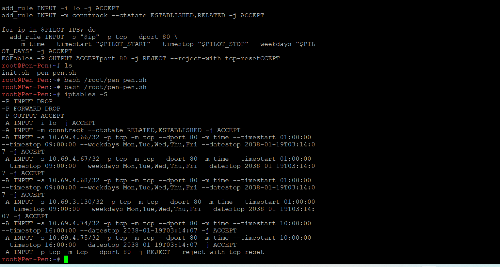 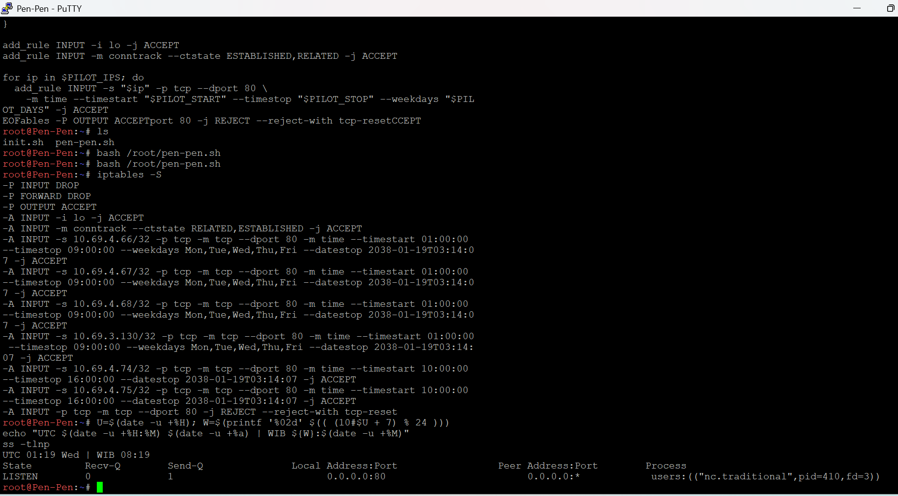
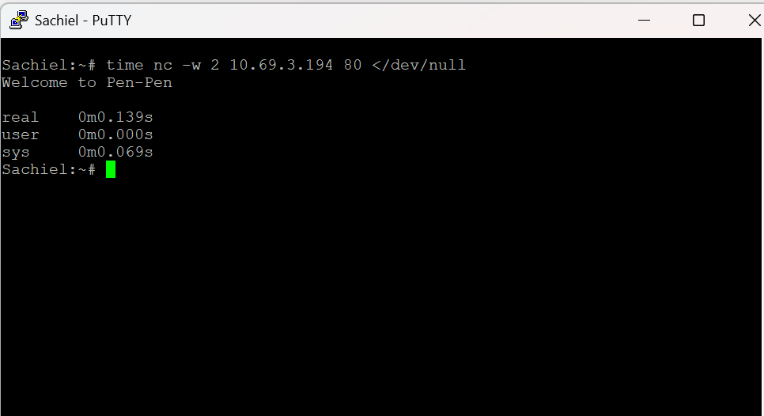
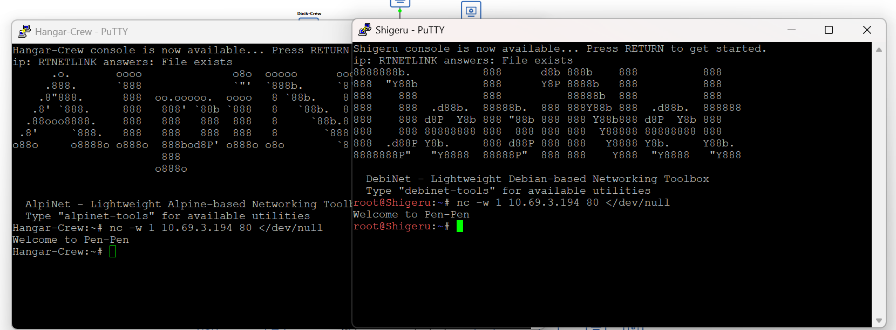
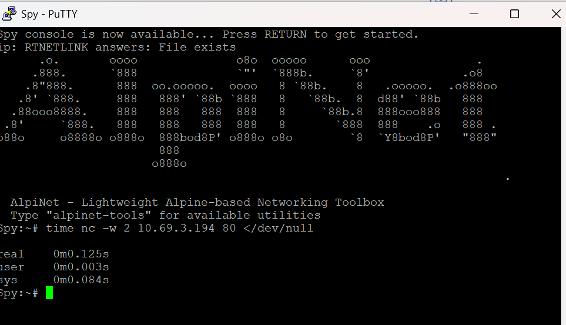
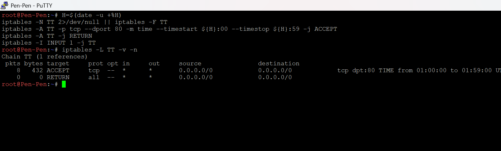
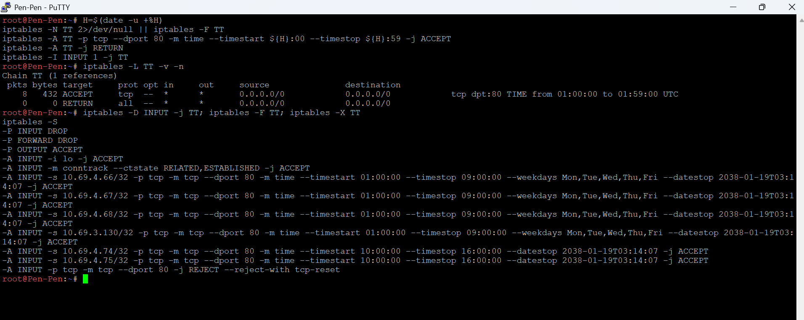
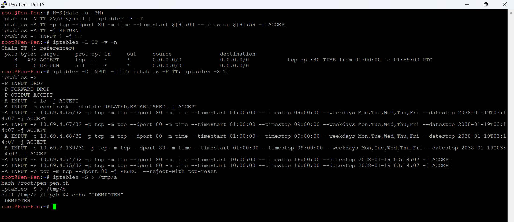

---

### Soal 15: Rate Limit Ping `Tokyo3-Core`

Pada [script/tokyo3-core.sh](script/tokyo3-core.sh) (`/root/tokyo3-core.sh`), `Tokyo3-Core` dibatasi
agar hanya menjawab maksimal `5` ICMP `echo-request` per detik, dan kelebihannya dibuang. Tiga hal
menentukan berhasil atau tidaknya soal ini: rule `ACCEPT` berlimit harus berada **di atas** rule
`DROP`, hanya `--icmp-type 8` (echo-request) yang dibatasi - bukan `-p icmp` polos - dan rule ICMP
harus berada **di atas** `conntrack`.

```text
-P INPUT DROP
-A INPUT -i lo -j ACCEPT
-A INPUT -p icmp -m icmp --icmp-type 8 -m limit --limit 5/sec --limit-burst 5 -j ACCEPT
-A INPUT -p icmp -m icmp --icmp-type 8 -j DROP
-A INPUT -m conntrack --ctstate RELATED,ESTABLISHED -j ACCEPT
-A INPUT -p tcp -m multiport --dports 80,8080 -j ACCEPT
```

**Penyebab kegagalan percobaan pertama:**

Percobaan awal menghasilkan `50 packets transmitted, 50 received, 0% packet loss` - tidak ada satu
pun paket yang dibuang. Penyebabnya urutan rule: `ESTABLISHED,RELATED` sempat berada **di atas**
rule limit. Kernel mencatat `echo-request` pertama sebagai `NEW`, tetapi begitu balasannya datang
entri `conntrack` berubah menjadi `ESTABLISHED`, sehingga seluruh `echo-request` berikutnya dalam
satu run `ping` (ID ICMP sama) langsung diterima rule conntrack dan rule limit tidak pernah
dievaluasi. Gejalanya terbaca dari counter: rule conntrack naik ≈`50` sementara rule `DROP` tetap
`0`.

Perbaikannya adalah memindahkan rule ICMP ke atas rule conntrack. Dengan urutan itu, ping masuk
melewati `limit` lebih dulu, sementara balasan `echo-reply` (tipe `0`) untuk ping yang dikirim
`Tokyo3-Core` sendiri tidak pernah cocok dengan `--icmp-type 8` sehingga tetap normal.

**Bukti verifikasi:**

- `ping -i 0.1 -c 50` dari `Lilith`: diterima ±`30` paket, loss ±`40%` (bukan `0%`, bukan `100%`).
- Counter rule `ACCEPT` berlimit ≈`30` dan rule `DROP` ≈`20` - keduanya naik.
- `ping -c 1` berjeda `3` detik sebanyak lima kali: seluruhnya `0% packet loss`.
- `ping -i 0.1 -c 50` dari `Tokyo3-Core` ke `Lilith`: `0% packet loss` **dan** counter `DROP` tetap
  `0`, membuktikan ping keluar tidak dibatasi.
- `nc` ke port `80` dan `8080` tetap membalas banner.

```sh
# dijalankan di Tokyo3-Core (reset counter sebelum uji)
iptables -Z INPUT
iptables -S INPUT

# dijalankan di Lilith (ping rapat -> sebagian hilang)
ping -i 0.1 -c 50 10.69.4.106

# dijalankan di Tokyo3-Core (counter ACCEPT ~30, DROP ~20)
iptables -L INPUT -v -n --line-numbers

# dijalankan di Lilith (ping berjeda 3 detik -> semua berhasil)
for i in 1 2 3 4 5; do
  ping -c 1 -W 2 10.69.4.106 | grep -E 'icmp_seq|packet loss'
  sleep 3
done

# dijalankan di Tokyo3-Core (ping keluar tidak dibatasi)
iptables -Z INPUT
ping -i 0.1 -c 50 10.69.4.74
iptables -L INPUT -v -n --line-numbers
```

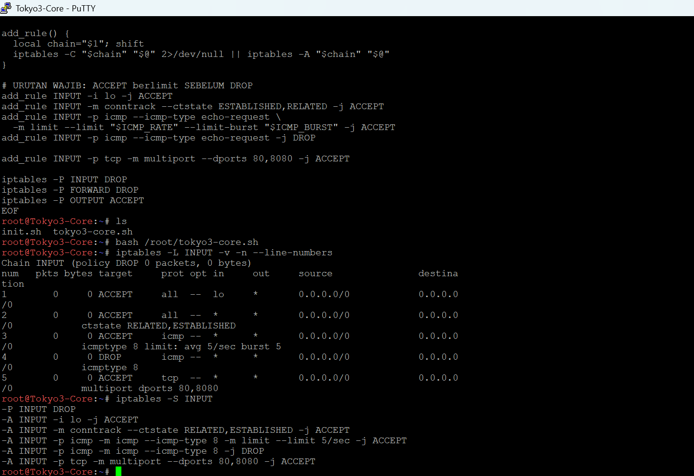
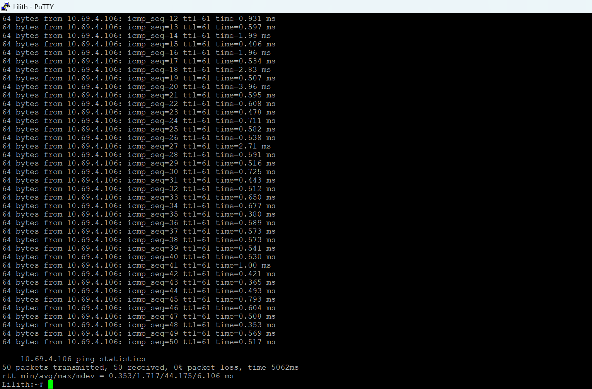
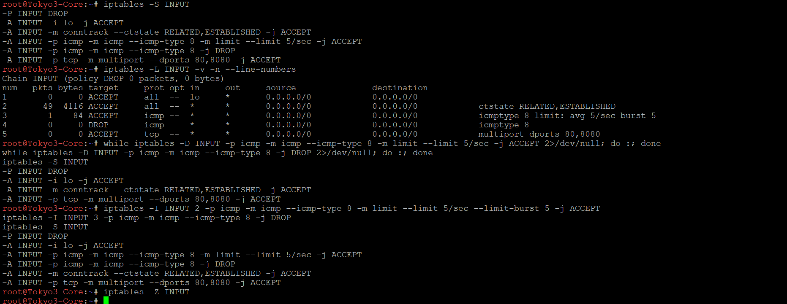
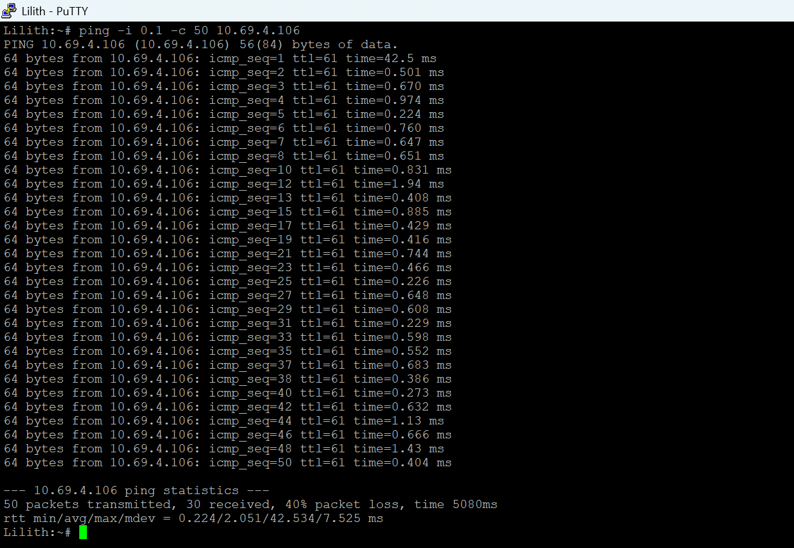
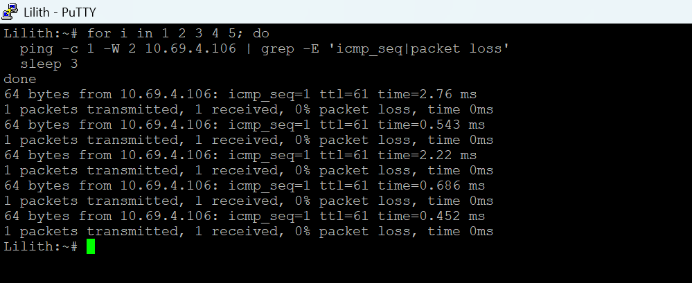
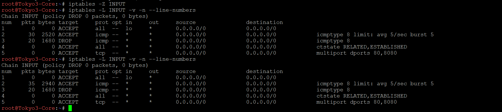

---

### Soal 16: Deteksi Pencuri di `Tokyo3-Core`

Pada [script/tokyo3-core.sh](script/tokyo3-core.sh) yang sama, ditambahkan pasangan rule untuk
`Dummy-Plug` (`10.69.4.51`): setiap koneksi TCP menuju port `22`, `23`, dan `3306` dicatat ke log
kernel dengan prefix `SCAN-NERV:` lalu ditolak seketika. Karena `Tokyo3-Core` hanya punya satu
interface, pembatasan memakai `-s 10.69.4.51` dan bukan `-i eth0` - kalau memakai interface, seluruh
klien akan terkena.

```text
-A INPUT -s 10.69.4.51/32 -p tcp -m multiport --dports 22,23,3306 -j LOG --log-prefix "SCAN-NERV: " --log-level 4
-A INPUT -s 10.69.4.51/32 -p tcp -m multiport --dports 22,23,3306 -j REJECT --reject-with tcp-reset
```

Urutan rule menentukan: `LOG` harus berada **di atas** `REJECT`, karena target `REJECT` menghentikan
evaluasi chain sehingga `LOG` di bawahnya tidak akan pernah dijalankan. Keduanya juga harus di atas
`conntrack`, dengan alasan yang sama seperti Soal 15 - percobaan ulang tidak boleh lolos sebagai
`ESTABLISHED` sebelum sempat dicatat.

**Bukti verifikasi:**

- `Dummy-Plug` → port `22`, `23`, `3306`: `Connection refused` dalam < `1` detik.
- Counter rule `LOG` = `3` dan `REJECT` = `3` setelah tiga percobaan, membuktikan setiap paket yang
  ditolak juga tercatat. Log kernel sering tidak terlihat di dalam container, sehingga counter rule
  inilah yang dipakai sebagai bukti utama.
- `Dummy-Plug` → port `80` dan `8080`: banner `Welcome to Tokyo3-Core` dan `syifa imutz` tetap
  muncul.
- `Lilith` → port `22`: timeout (bukan `refused`), dan counter `LOG` **tidak** bertambah -
  membuktikan rule hanya berlaku untuk `Dummy-Plug`.

```sh
# dijalankan di Tokyo3-Core
iptables -Z INPUT
iptables -S INPUT

# dijalankan di Dummy-Plug (harus refused cepat)
for p in 22 23 3306; do echo "=== port $p ==="; time nc -zv -w 3 10.69.4.106 $p; done

# dijalankan di Dummy-Plug (port normal tetap jalan)
nc -w 2 10.69.4.106 80   </dev/null
nc -w 2 10.69.4.106 8080 </dev/null

# dijalankan di Tokyo3-Core (counter LOG = REJECT = 3)
iptables -L INPUT -v -n --line-numbers | grep -E 'SCAN|LOG|REJECT'

# dijalankan di Lilith (klien lain tidak tercatat)
nc -w 2 10.69.4.106 80 </dev/null
time nc -zv -w 2 10.69.4.106 22
```

Isi log kernel bisa dilihat dengan `dmesg | grep SCAN-NERV`, atau `sudo dmesg` di host GNS3 bila
`dmesg` dibatasi di dalam container.

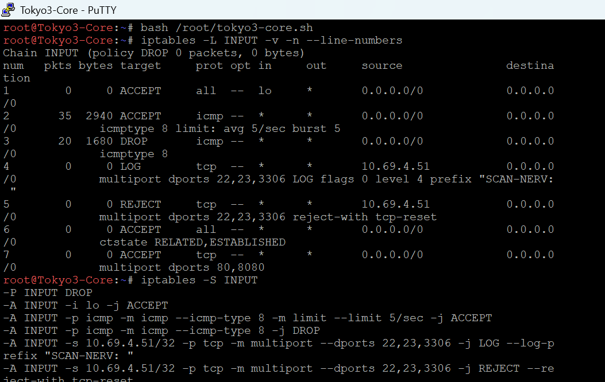
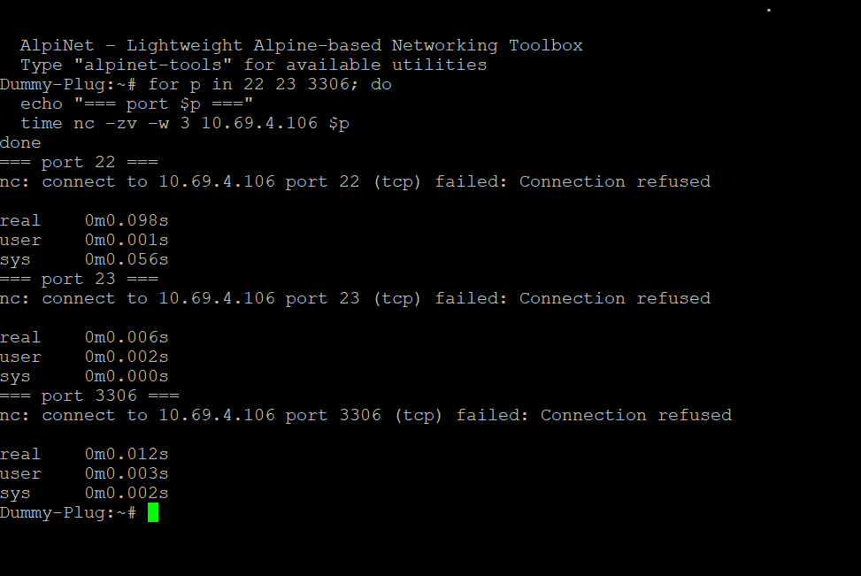
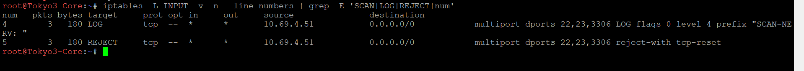
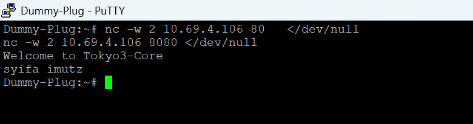
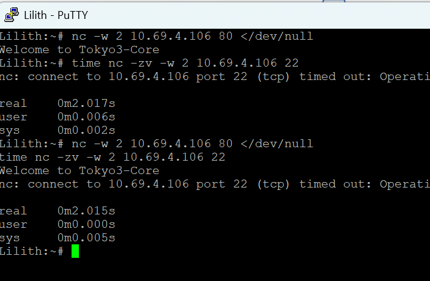
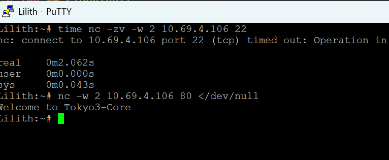
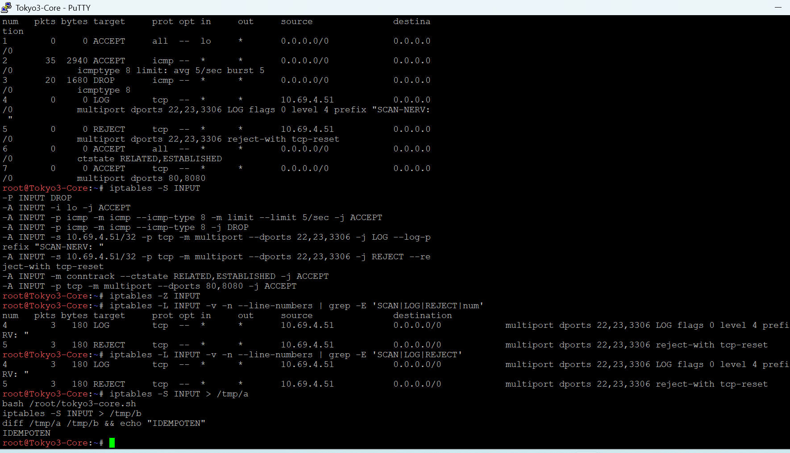

---

### Soal 17: Sihir Hitam di Jalur Paket (`Fuyutsuki`)

Pada [script/fuyutsuki.sh](script/fuyutsuki.sh) (`/root/fuyutsuki.sh`), `Fuyutsuki` - gateway
`Switch-Terminal` - dijadikan mesin pengalihan. Setiap koneksi TCP dari `Magi-Casper` (`10.69.4.58`)
menuju `Zeruel:9000` diubah tujuannya ke `Pen-Pen:9000`, sementara Casper tetap melihat dirinya
sedang berbicara dengan Zeruel.

```sh
# 1) DNAT: Zeruel:9000 -> Pen-Pen:9000
iptables -t nat -A PREROUTING -s 10.69.4.58 -p tcp -d 10.69.4.82 --dport 9000 \
  -j DNAT --to-destination 10.69.3.194:9000

# 2) MASQUERADE: source -> IP Fuyutsuki, agar balasan Pen-Pen kembali dengan benar
iptables -t nat -A POSTROUTING -s 10.69.4.58 -d 10.69.3.194 -p tcp --dport 9000 \
  -j MASQUERADE
```

DNAT dipasang di `PREROUTING` karena paket berasal dari host lain - `OUTPUT` hanya untuk paket yang
lahir di `Fuyutsuki` sendiri. MASQUERADE wajib ada: tanpa itu paket sampai ke `Pen-Pen` dengan
source `10.69.4.58`, sehingga `Pen-Pen` membalas langsung ke Casper dan Casper menolaknya karena
mengira sedang bicara dengan `10.69.4.82`. Dengan MASQUERADE, balasan melewati `Fuyutsuki`, dan DNAT
otomatis membalik alamat tujuan kembali menjadi `Zeruel`. Rule dibatasi `-p tcp --dport 9000` supaya
ICMP dan layanan lain tidak ikut dibelokkan.

Listener `9000` dinyalakan di `Pen-Pen` ([script/pen-pen.sh](script/pen-pen.sh)) dan di `Zeruel`
([script/zeruel.sh](script/zeruel.sh)). Listener Zeruel sengaja tetap hidup sebagai pembanding -
port terbuka, tetapi tidak pernah menerima paket dari Casper.

**Bukti verifikasi:**

- `Magi-Casper` → `10.69.4.82:9000` (`nc -w 2`): `exit=0`, dan pesan muncul di
  `/var/log/pen-pen-9000.log`.
- `/var/log/zeruel-9000.log` berisi **`0` baris** - pesan tidak pernah sampai ke Zeruel.
- `ss -tn | grep 9000` di Casper: peer tetap `10.69.4.82:9000`, bukan `10.69.3.194`.
- `ping -c 3 10.69.4.82` dari Casper: `0% packet loss` - ping tidak dialihkan.
- `conntrack -L` di `Fuyutsuki`: satu entri memuat `orig src=10.69.4.58 dst=10.69.4.82 dport=9000`
  dan `reply src=10.69.3.194 dst=10.69.4.169`.

```sh
# dijalankan di Zeruel (listener pembanding)
bash /root/zeruel.sh
ss -tlnp | grep 9000
: > /var/log/zeruel-9000.log

# dijalankan di Pen-Pen (listener penampung)
bash /root/pen-pen.sh
ss -tlnp | grep 9000
: > /var/log/pen-pen-9000.log

# dijalankan di Fuyutsuki
bash /root/fuyutsuki.sh
iptables -t nat -S PREROUTING
iptables -t nat -S POSTROUTING

# dijalankan di Magi-Casper
printf 'pesan rahasia soal17 dari Casper\n' | nc -w 2 10.69.4.82 9000; echo "exit=$?"
ss -tn | grep 9000
ping -c 3 10.69.4.82

# dijalankan di Pen-Pen (pesan muncul di sini)
cat /var/log/pen-pen-9000.log

# dijalankan di Zeruel (harus kosong)
wc -l /var/log/zeruel-9000.log

# dijalankan di Fuyutsuki (tabel conntrack)
conntrack -L 2>/dev/null | grep 9000
cat /proc/net/nf_conntrack | grep 9000
```

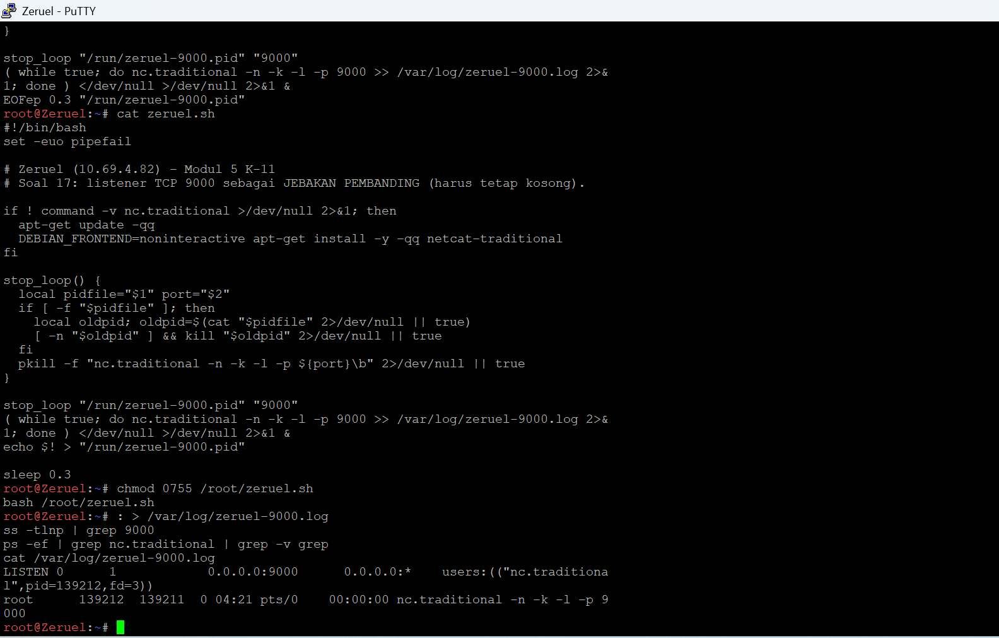
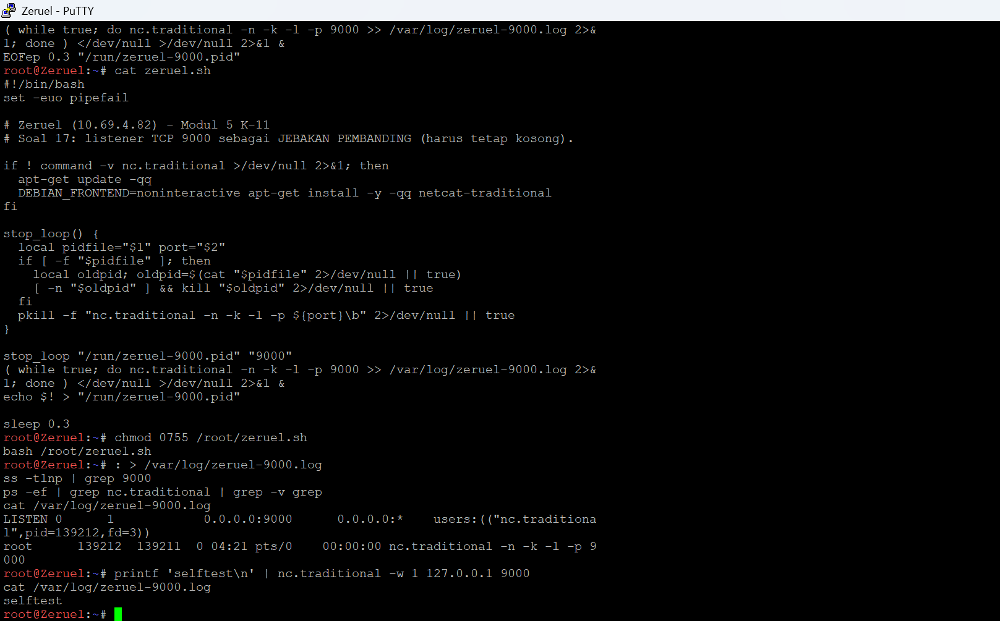
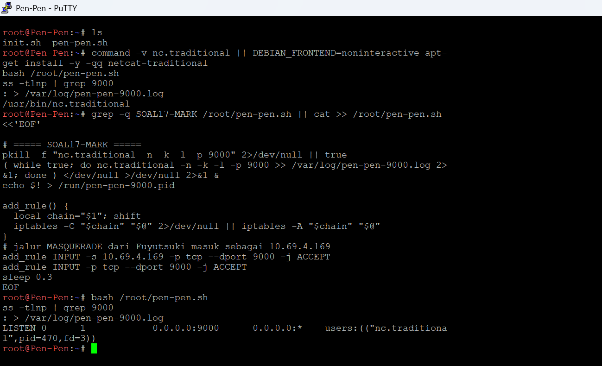


---

### Soal 18: Gerbang Monolith dan Radar (`Shigeru`)

Pada [script/shigeru.sh](script/shigeru.sh) (`/root/shigeru.sh`), `Shigeru` dijadikan gerbang zona
sensitif. Yang dinilai bukan daftar alamat, melainkan **arah datang paket**: apa pun yang masuk
lewat `eth0` (sisi menghadap `Gendo`) dianggap berasal dari luar zona. Dengan begitu subnet baru
otomatis ikut terblokir tanpa perlu menambah rule.

```text
-A FORWARD -m conntrack --ctstate RELATED,ESTABLISHED -j ACCEPT
-A FORWARD -i eth1 -j ACCEPT
-A FORWARD -i eth2 -j ACCEPT
-A FORWARD -i eth0 -s 10.69.4.56/29 -p icmp --icmp-type 8 -j ACCEPT
-A FORWARD -i eth0 -j DROP
```

Rule conntrack harus paling atas. `FORWARD` hanya melihat paket yang diteruskan, sedangkan balasan
untuk koneksi yang dimulai zona masuk lewat `eth0` - bila `-i eth0 -j DROP` berada di atasnya, semua
koneksi keluar zona akan menggantung. Zona sendiri dinyatakan per-interface (`eth1` untuk
`Switch-Monolith`, `eth2` menuju `Switch-Radar`), bukan per daftar host. Pengecualian dibatasi
`--icmp-type 8` agar hanya ping dari subnet Terminal yang diizinkan, sementara TCP ke port sensitif
tetap tertutup.

**Bukti verifikasi:**

- `Magi-Casper` (`10.69.4.58`) → `ping 10.69.4.82`: `0% packet loss` (pengecualian Terminal).
- `Lilith` (`10.69.4.74`) → `ping 10.69.4.82`: `100% packet loss`.
- `Zeruel` → `Lilith` dan `8.8.8.8`: `0% packet loss` (zona boleh memulai koneksi).
- `Radar-Array` (`10.69.4.90`) → `Lilith`: `0% packet loss` (jalur `eth2` juga berfungsi).
- Alamat baru `10.69.4.180` (blok bebas `10.69.4.176/28`) → `ping 10.69.4.82`: `100% packet loss`
  tanpa pernah didaftarkan di `Shigeru` - membuktikan blokir berbasis arah, bukan daftar subnet.

```sh
# dijalankan di Shigeru
bash /root/shigeru.sh
iptables -S FORWARD

# dijalankan di Magi-Casper (harus berhasil)
ping -c 3 10.69.4.82

# dijalankan di Lilith (harus gagal)
ping -c 3 -W 2 10.69.4.82

# dijalankan di Zeruel (harus berhasil)
ping -c 3 10.69.4.74
ping -c 3 8.8.8.8

# dijalankan di Radar-Array (harus berhasil)
ping -c 3 10.69.4.74

# bukti subnet baru ikut terblokir
# di Lilith
ip addr add 10.69.4.180/28 dev eth0
# di Gendo
ip route replace 10.69.4.176/28 via 10.69.4.170 dev eth8
# di Lilith
ping -c 3 -W 2 -I 10.69.4.180 10.69.4.82
# bersihkan
ip addr del 10.69.4.180/28 dev eth0
```


---

### Soal 19: Hukuman untuk Sang Pengkhianat (`Armisael`)

Isolasi `Armisael` (`10.69.4.83`) tidak dipasang di dalam `Armisael`, karena node itu dianggap sudah
dikuasai penyerang - aturan di dalamnya bisa dihapus sendiri. Isolasi dikerjakan dari luar, dan
karena `Armisael` dan `Zeruel` berada pada `Switch-Monolith` yang sama, blokir di router saja tidak
cukup: trafik antar-host satu subnet berjalan di L2 dan tidak pernah melewati chain `FORWARD`
`Shigeru`. Karena itu dipakai dua lapis.

| Lapis         | Dikerjakan di                                                    | Menangani                                       |
| ------------- | ---------------------------------------------------------------- | ----------------------------------------------- |
| L2 (utama)    | `Switch-Monolith`, port `port2` (Armisael) dipindah ke VLAN `99` | Armisael ↔ Zeruel dan Armisael ↔ gateway        |
| L3 (cadangan) | `Shigeru`, chain `FORWARD`                                       | sisa trafik Armisael yang sempat naik ke router |

Pada [script/shigeru.sh](script/shigeru.sh), rule Armisael diletakkan di **posisi teratas** -
sebelum rule conntrack - agar sesi yang sudah terbentuk sebelum isolasi ikut terputus.

```text
-A FORWARD -s 10.69.4.83/32 -j DROP
-A FORWARD -d 10.69.4.83/32 -j DROP
```

Memindahkan port ke VLAN terpisah membuat `Armisael` keluar dari broadcast domain, sehingga ARP ke
gateway `10.69.4.81` pun tidak terjawab. Efeknya total: bukan hanya paket yang dibuang di router,
tetapi tidak ada jalur keluar sama sekali. Port `port1` (`Zeruel`) dan `port0` (ke `Shigeru`) tetap
di VLAN `1`, sehingga `Zeruel` tidak ikut terhukum.

Listener `9000` dinyalakan di `Armisael` ([script/armisael.sh](script/armisael.sh)) dan `Lilith`
([script/lilith.sh](script/lilith.sh)) sebagai tujuan uji. `Seele` adalah alamat internet `8.8.8.8`:
uji ping memakai `8.8.8.8` dan uji `nc` memakai TCP port `53`.

**Bukti verifikasi:**

- `Armisael` → gateway (`10.69.4.81`), `Zeruel`, `Lilith`, dan `8.8.8.8`: seluruhnya
  `100% packet loss`, termasuk ke gateway sendiri.
- `Armisael` → `Zeruel:9000`, `Lilith:9000`, dan `8.8.8.8:53`: seluruhnya gagal.
- `iptables -S` di `Armisael`: **kosong** - tidak ada rule isolasi di dalam node, sementara
  `ss -tlnp` tetap menunjukkan listener `9000` dalam keadaan `LISTEN`. Ini membuktikan kegagalan
  komunikasi murni berasal dari isolasi jaringan, bukan karena layanan dimatikan.
- `Zeruel` → gateway, `Lilith`, `8.8.8.8`, serta `Lilith:9000` dan `8.8.8.8:53`: seluruhnya
  berhasil.

```sh
# GUI: Switch-Monolith -> Configure -> Ports
#   port0 (Shigeru)  VLAN 1
#   port1 (Zeruel)   VLAN 1
#   port2 (Armisael) VLAN 99

# dijalankan di Shigeru
bash /root/shigeru.sh
iptables -S FORWARD

# dijalankan di Armisael (listener uji saja, tanpa rule isolasi)
sh /root/armisael.sh
ss -tlnp | grep 9000
iptables -S

# dijalankan di Zeruel dan Lilith
sh /root/zeruel.sh
ss -tlnp | grep 9000
sh /root/lilith.sh
ss -tlnp | grep 9000

# dijalankan di Armisael (semua harus gagal)
ping -c 3 -W 2 10.69.4.81
ping -c 3 -W 2 10.69.4.82
ping -c 3 -W 2 10.69.4.74
ping -c 3 -W 2 8.8.8.8
nc -zv -w 3 10.69.4.82 9000
nc -zv -w 3 10.69.4.74 9000
nc -zv -w 3 8.8.8.8 53

# dijalankan di Zeruel (semua harus berhasil)
ping -c 3 10.69.4.81
ping -c 3 10.69.4.74
ping -c 3 8.8.8.8
nc -zv -w 3 10.69.4.74 9000
nc -zv -w 3 8.8.8.8 53
```


---

### Soal 20: Siap Dihancurkan, Siap Dibangun Lagi

Uji kebakaran dilakukan pada tiga node yang mewakili tiga pola konfigurasi berbeda: `Fuyutsuki`
(satu-satunya router dengan tabel `nat` selain `Gendo`), `Shigeru` (rule filter yang urutannya
dinilai pada Soal 18 dan 19), dan `Tokyo3-Core` (rule paling rumit: limit ICMP di atas conntrack
ditambah `LOG` di atas `REJECT`). Bila ketiganya lolos, node lain mengikuti karena polanya sama.

Helper [script/drill.sh](script/drill.sh) menjalankan siklus lengkap: simpan rule dengan
`iptables-save`, kosongkan seluruh tabel, hapus rute yang ditambahkan sendiri, lalu pulihkan dengan
`iptables-restore` dan `/root/<nama>.sh` sebanyak **dua kali**. Hasil kedua pemulihan dibandingkan
baris per baris, bukan hanya jumlah barisnya.

Kuncinya ada dua. `iptables-restore` memuat tabel secara utuh (flush per tabel lalu isi), sehingga
dijalankan berulang hasilnya sama - berbeda dengan `iptables -A` yang menambah dan akan
menduplikasi. Sementara rute dipulihkan lewat `ip route replace` di `/root/<nama>.sh`, yang bersifat
mengganti bila sudah ada, bukan `ip route add` yang akan gagal atau menumpuk.

**Peringatan:** jangan memilih `Gendo`. Rute `default`-nya berasal dari DHCP `NAT1`, bukan dari
`gendo.sh`, sehingga tidak bisa dipulihkan oleh script dan akan memutus internet seluruh lab. Jangan
pula memakai `--noflush` pada `iptables-restore` - justru itu yang menduplikasi rule.

**Bukti verifikasi:**

- `iptables -S`, `iptables -t nat -S`, dan `ip route show` setelah pemulihan pertama dan kedua:
  jumlah baris sama dan isinya identik (`diff` tanpa keluaran).
- `HASIL: IDEMPOTEN` keluar untuk ketiga node.
- `Fuyutsuki`: `DNAT --to-destination 10.69.3.194:9000` dan `MASQUERADE` kembali, tiga rute kembali.
- `Shigeru`: rule `-s`/`-d 10.69.4.83` tetap di posisi `1`–`2`, di atas `conntrack`.
- `Tokyo3-Core`: listener `80` dan `8080` hidup, dan `nc 127.0.0.1 80` membalas banner.
- Setelah drill, fitur Soal 13–19 masih berjalan: DNAT `9000` sampai ke `Pen-Pen`, gerbang `Shigeru`
  masih membedakan Casper dan Lilith, dan `Armisael` tetap terisolasi.

```sh
# backup dulu di tiap node
ip route show   > /root/$(hostname | tr 'A-Z' 'a-z').route.bak
ip -4 addr show > /root/$(hostname | tr 'A-Z' 'a-z').addr.bak

# pasang helper (isi lengkap: script/drill.sh)
cat > /root/drill.sh <<'DRILL'
#!/bin/bash
set -uo pipefail
NAME="${1:?pakai: /root/drill.sh <nama> [rute ...]}"
shift || true
DEL_ROUTES=("$@")
RULES="/root/${NAME}.rules"
SNAP="/root/${NAME}.snap"

command -v iptables-save >/dev/null 2>&1 || {
  apt-get update -qq
  DEBIAN_FRONTEND=noninteractive apt-get install -y -qq iptables
}
[ -f "/root/${NAME}.sh" ] || { echo "FATAL: /root/${NAME}.sh tidak ada."; exit 1; }

cf() { iptables -S 2>/dev/null | wc -l; }
cn() { iptables -t nat -S 2>/dev/null | wc -l; }
cr() { ip route show | wc -l; }

echo "=== [0] AWAL   : filter=$(cf) nat=$(cn) route=$(cr)"

iptables-save > "$RULES"
[ -s "$RULES" ] || { echo "FATAL: rules kosong."; exit 1; }
iptables -S > "${SNAP}.filter.0"; iptables -t nat -S > "${SNAP}.nat.0"; ip route show > "${SNAP}.route.0"
echo "=== [1] SAVED  : $RULES"

for t in filter nat mangle raw; do
  iptables -t "$t" -F 2>/dev/null || true
  iptables -t "$t" -X 2>/dev/null || true
done
for c in INPUT FORWARD OUTPUT; do iptables -P "$c" ACCEPT; done
echo "=== [2] FLUSH  : filter=$(cf) nat=$(cn)"

for r in "${DEL_ROUTES[@]:-}"; do
  [ -z "$r" ] && continue
  while ip route del "$r" 2>/dev/null; do :; done
done
echo "=== [3] RUTE   : $(cr)"

iptables-restore < "$RULES"
bash "/root/${NAME}.sh" >/dev/null 2>&1
iptables -S > "${SNAP}.filter.1"; iptables -t nat -S > "${SNAP}.nat.1"; ip route show > "${SNAP}.route.1"
echo "=== [4] PULIH#1: filter=$(cf) nat=$(cn) route=$(cr)"

iptables-restore < "$RULES"
bash "/root/${NAME}.sh" >/dev/null 2>&1
iptables -S > "${SNAP}.filter.2"; iptables -t nat -S > "${SNAP}.nat.2"; ip route show > "${SNAP}.route.2"
echo "=== [5] PULIH#2: filter=$(cf) nat=$(cn) route=$(cr)"

echo
rc=0
for p in filter nat route; do
  a=$(wc -l < "${SNAP}.${p}.1"); b=$(wc -l < "${SNAP}.${p}.2")
  if [ "$a" = "$b" ]; then echo "  [OK]   ${p}: ${a} == ${b}"; else echo "  [FAIL] ${p}: ${a} != ${b}"; rc=1; fi
  diff -q "${SNAP}.${p}.1" "${SNAP}.${p}.2" >/dev/null 2>&1 && echo "         identik" || { echo "         BEDA"; rc=1; }
done
[ "$rc" = 0 ] && echo "HASIL: IDEMPOTEN" || echo "HASIL: ADA PERBEDAAN"
exit "$rc"
DRILL

chmod 0755 /root/drill.sh

# jalankan drill
bash /root/drill.sh fuyutsuki default 10.69.3.192/27 10.69.4.72/29
bash /root/drill.sh shigeru default 10.69.4.88/29
bash /root/drill.sh tokyo3-core

# cek manual jumlah baris (pulih#1 vs pulih#2 harus sama)
bash /root/<nama>.sh
iptables -S | wc -l
iptables -t nat -S | wc -l
bash /root/<nama>.sh
iptables -S | wc -l
iptables -t nat -S | wc -l

# uji node berfungsi lagi
# Fuyutsuki: DNAT masih jalan
printf 'pasca20\n' | nc -w 2 10.69.4.82 9000; echo "exit=$?"
tail -n 3 /var/log/pen-pen-9000.log

# Shigeru: gerbang dan isolasi
ping -c 2 10.69.4.82            # dari Casper: berhasil
ping -c 2 -W 1 10.69.4.82       # dari Lilith: gagal
ping -c 2 -W 1 10.69.4.74       # dari Armisael: gagal

# Tokyo3-Core: limit dan layanan
ping -i 0.1 -c 20 10.69.4.106
nc -w 2 10.69.4.106 8080 </dev/null
```


> **Temuan saat drill - perlu diulang.** Pada pemulihan `Tokyo3-Core`, urutan rule hasil
> `iptables-restore` menempatkan `conntrack` di atas rule limit ICMP (`conntrack` posisi 3,
> `icmp limit` posisi 4, `icmp DROP` posisi 7). Akibatnya `ping -i 0.1 -c 20` tetap
> `0% packet loss` - rate limit tidak bekerja, sama seperti gejala Soal 15 sebelum diperbaiki.
> Penyebabnya: berkas `/root/tokyo3-core.rules` yang di-save masih memuat urutan lama. Perbaikannya:
> jalankan `bash /root/tokyo3-core.sh` lebih dulu (script memakai `place_rule` yang menata posisi),
> baru lakukan `iptables-save`, lalu ulangi drill dan ambil ulang screenshot.

---

**Export Project:** proyek GNS3 diekspor ke [K-11-MODUL-5.gns3project](K-11-MODUL-5.gns3project).
